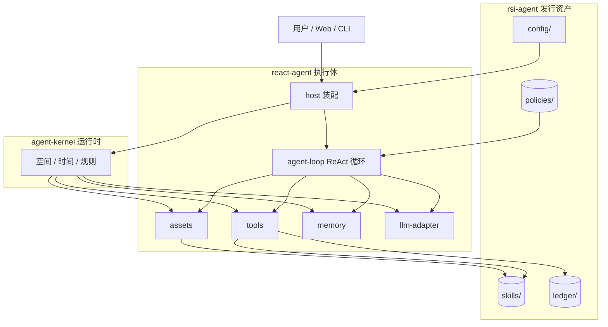
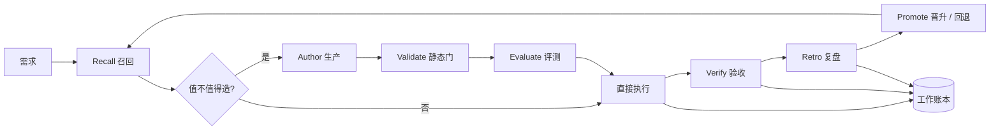
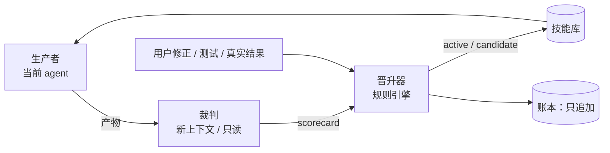

# rsi-agent 项目简介与架构图

> 一句话：rsi-agent 不是「会自己改代码的 agent」，而是**把技能当作可验收资产、用证据闭环持续改进的 agent 发行形态**。

## 1. 理念

### 1.1 能力单元是技能，不是提示词

agent 要取代具体工作，靠的不是一次性的回答，而是**可复用、可验收、可回退的技能**。
技能不是一段说明，而是一个能力单元：认知（怎么判断）+ 执行（怎么做）+ 验收（怎么算做好）。

### 1.2 造技能的能力，比技能本身更重要

真正稀缺的不是某一个技能，而是**从需求到技能的生产能力**：
判断值不值得造 → 还原专业 → 写成契约 → 设计案例 → 客观评测 → 沉淀经验。
这就是 creat-skill 的位置：它不是技能库，而是**技能编译器 + 验收规范**。

### 1.3 没有客观标准的改进，只是噪声

“模型觉得更好了”不能算进化。进化必须同时有：
**基线**（改之前什么样）、**案例**（怎么验证）、**外部信号**（用户/测试/真实结果）、**回退点**（变差怎么办）。

### 1.4 运行时不变，资产与策略进化

内核、裁判、账本内容保持稳定；可进化的是技能、工具、LLM 路由、记忆策略。
**内核是地基，裁判是尺子，账本是审计；这三样不能由被评估者自己改。**

### 1.5 轻资产，重验收

技能仍然是「目录 + Markdown + 可选工具」，不引入包管理器、数据库、第二个运行时。
复杂的是验收与证据，不是平台。

## 2. 项目边界

| 项目 | 本质 | 在 RSI 中的角色 |
|---|---|---|
| [agent-kernel](../agent-kernel/README.md) | 空间 / 时间 / 规则管家 | 提供隔离、调度、契约、conformance；不感知技能 |
| [react-agent](../react-agent/README.md) | 通用 agent 执行体 | ReAct 循环、工具、资产、记忆、Web、trace |
| **rsi-agent** | react-agent 的发行形态 | 技能生产线、评测、证据、晋升策略、预置技能 |
| [creat-skill](../creat-skill/SKILL.md) | 认知生产方法论 | 还原、契约、三级验收；被 vendored 进 rsi-agent |
| [project-dev](../project-dev-skill/skills/project-dev/SKILL.md) | 运行体开发方法论 | P/Q/I、PLAN 迭代；负责带工具技能的代码层 |

**边界铁律**：rsi-agent 不直接改内核；内核不承载 RSI 语义；通用执行体只开三个接缝。

## 3. 架构图

### 3.1 运行时分层



### 3.2 RSI 闭环



### 3.3 评估三角色



**关键**：生产者不能给自己打分；裁判不能改技能；晋升器不做主观判断，只检查证据等级。

## 4. 分层 RSI 矩阵

| 层 | 能否 RSI | 评估器 | 晋升条件 | 风险 |
|---|---|---|---|---|
| 技能内容 | 可以 | 案例回放 + 盲评 | E1/E2/E3 任一 | 低 |
| 技能工具（代码） | 可以 | 测试 + conformance | E2 必须 | 中，需沙箱 |
| LLM 路由 / 模型选择 | 部分可以 | 基准集 + 成本 / 延迟 | E2/E3 | 中，需回退 |
| Prompt / 策略 | 有限可以 | A/B + 外部信号 | 外部信号 + 人工 | 高 |
| 记忆策略（检索/摘要） | 可以 | 任务成功率 + 召回准确率 | E2/E3 | 中 |
| 记忆内容（账本） | **不可以改写** | 只追加 | — | 会失去审计 |
| 评估器 | **不可以自改** | 外部校准集 | 人工 | 自评会共谋 |
| agent-kernel | **不可以** | conformance | 人工 | 内核必须稳定 |

证据等级：

| 级别 | 证据 | 是否可晋升 |
|---|---|---|
| E1 | 用户明确确认 / 修正 | 是 |
| E2 | 确定性测试 / eval 通过 | 是 |
| E3 | 真实任务结果 | 是 |
| E4 | 另一模型盲评 | 辅助 |
| E5 | 同模型自评 | 否 |

## 5. 实现方法

### 5.1 四个阶段

| 阶段 | 目标 | 关键动作 | 验收 |
|---|---|---|---|
| Phase 1 | Rust 接缝 | host 装配 spec、assets 校验/状态、agent-loop 验收钩子 | `cargo test` 全绿，默认行为不变 |
| Phase 2 | 生产线闭环 | 预置技能 + validate/eval/ledger + 真实任务 | 坏技能进不来，低分不晋升 |
| Phase 3 | 对比与退役 | A/B、盲评、使用率、看板 | 结果可复现，退役可恢复 |
| Phase 4 | 例行化 RSI | 外部信号触发复盘、提案、月度报告 | 没有外部信号不晋升 |

### 5.2 核心产物

| 产物 | 位置 | 作用 |
|---|---|---|
| `skill.json` | `skills/{name}/` | 契约：触发、输入输出、验收标准 |
| `SKILL.md` | `skills/{name}/` | 认知：判断标准与方法 |
| `evals/cases.jsonl` | `skills/{name}/evals/` | 可回放的验收案例 |
| `state.json` | `skills/{name}/` | 生命周期与版本状态 |
| `registry/` | `skills/{name}/` | failure-fix 与标杆 |
| `ledger/` | `rsi-agent/ledger/` | 工作账本与证据 |
| `policies/` | `rsi-agent/policies/` | 状态机、阈值、晋升规则 |

### 5.3 一次任务怎么走

```text
用户需求
  → Recall：先查已有技能与账本
  → Decide：值不值得造？不值得就直接做
  → Author：creat-skill 还原 + 契约 + 案例
  → Validate：结构不过关，不进候选
  → Evaluate：跑案例，和基线比
  → Execute：用技能完成任务
  → Verify：逐条核对验收
  → Retro：失败/修正写回 registry
  → Promote：有外部信号才 active
```

## 6. 与常见做法的区别

| 常见做法 | 问题 | rsi-agent 的选择 |
|---|---|---|
| 让 agent 自由改写自己 | 无法归因、容易自毁 | 只进化资产与策略，内核/裁判/账本冻结 |
| 只做 prompt 调优 | 没有基线，越调越玄 | 案例 + 基线 + 外部信号 |
| 建一个技能库 | 只存不验，越存越乱 | 每个技能带契约、案例、状态 |
| 多 agent 角色扮演 | 都是同一个模型在自说自话 | 生产者 / 裁判 / 晋升器职责分离 |
| 一开始就上插件/DB/图引擎 | 过度工程 | 轻资产，脚本优先，按需升级 |

## 7. 成功标准

1. 一个真实任务能完整走完闭环，并留下账本。
2. 一个坏技能进不来，一个低分候选升不上去。
3. 一次失败能变成下一次可召回的经验。
4. 全程未修改 agent-kernel；react-agent 只在三个接缝改动。
5. 所有产物仍是「目录 + Markdown + JSON」，无新增服务。

## 8. 术语

| 术语 | 含义 |
|---|---|
| RSI | 递归自我改进：用证据驱动资产与策略持续变好 |
| 生产线 | 从需求到技能的状态机（Recall→Decide→Author→Validate→Evaluate→Execute→Verify→Retro→Promote） |
| 外部信号 | 用户修正、确定性测试、真实任务结果；不是模型自评 |
| 盲评 | 裁判只看任务、产物、固定 rubric，不看版本标签与生产者理由 |
| 晋升器 | 按证据等级执行状态迁移的规则引擎，不是 agent |
| legacy | 可用的现有技能，但没有案例，不能自动晋升 |
