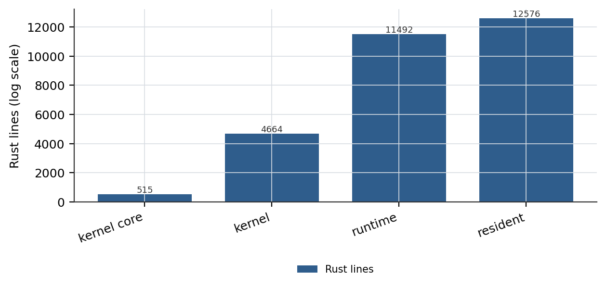
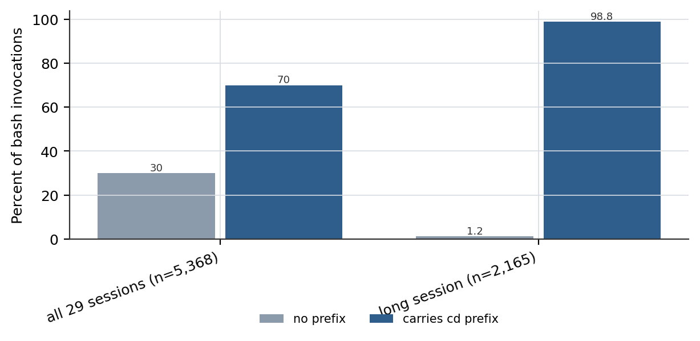

# Frozen Strata: Layered Self-Modification Governed by Immutability Boundaries

## Abstract

Self-improving agents are usually specified by what they may change. We study the complementary object: what they may not change. We report a three-layer agent stack in which each layer freezes a different thing — a 515-line kernel that freezes operational semantics while admitting four isolation strengths for plugins, a 11,492-line agent runtime that freezes the ReAct skeleton while admitting policy changes, and a 12,576-line resident agent that freezes the kernel, the judge, and the ledger while admitting skill acquisition. The stack runs a working coding assistant across 51 commits and 8 releases, with 60 active and 77 retired out-of-tree patches applied against a frozen core. Three measurements characterize the design. First, the kernel-to-resident ratio is 1:24 (515 kernel lines support 12,576 resident lines), so the frozen surface is small enough to audit as a unit. Second, forced immutability produces an audit signal that open self-modification destroys: four kernel and suite defects, including a silently serialized concurrency domain (≥1.2s before fix, 0.34s after) and a gap in the conformance suite itself, were located only because downstream residents could not patch upward and had to report. Third, the cost of a frozen contract that is specified imprecisely is paid in model tokens rather than in engineering hours: across 29 sessions and 5,368 bash invocations, 3,760 (70.0%) carry a redundant `cd` prefix that consumes 16.0% of all command characters, caused by a Windows extended-length path prefix leaking into `WORKSPACE_ROOT` and making `bash` silently execute in `C:\Windows` with exit code 0. We also report a 56.2% out-of-tree retirement share, against 48.7% of DGM-style variants failing to retain basic code-editing ability in prior work, and we do not claim that our gate has been exercised in production: the resident has 0 active promoted skills and 1 ledger record. The gate's decision behaviour, however, is measurable offline: submitting 11 synthetic skill directories (9 defective, 2 sound, each defective sample broken along a single dimension) to the deployed promotion entry point yields 9 correct verdicts out of 11 — 8 of 9 defective samples refused and the sound baseline admitted. The two leaks became findings in their own right: the acceptance check can be fed by a skill's own name, and per-case evidence signals are never read by the gate. We report both rather than patch them, so every positive statement we make about the gate is bounded to "the design intent holds on 8 of 9 defective samples". Note that we report no benchmark scores, because the system has not been evaluated on an external benchmark; every figure in this abstract is a structural quantity recomputable from the released traces and git history. The corpus covers 138 chat turns, 8,900 rounds and 11,431 tool calls, billing 229.42M tokens of input and output against 567.45M cache-read tokens, with no model training and therefore 0 GPU hours. Code, traces, and the ledger are released at https://github.com/zh2673-git/rsi-agent.

**Keywords**: self-modifying agents, immutable boundaries, plugin isolation, agent harness, audit signals

---

## 1 Introduction

A self-improving system is a system that can change its own behaviour. The literature has converged on a productive set of designs for *what* to change: prompts [EvoPrompt], agent scaffolding code [ADAS, Gödel Agent], tool libraries [Voyager], model weights [SEAL], and whole codebases under benchmark pressure [DGM]. What has received far less attention is the dual object. Every one of those systems also contains something it does *not* change, and that choice is usually an implementation residue rather than a stated architectural commitment. DGM's archive maintenance and parent selection are "fixed and not modifiable by the DGM" — described in the paper as a current limitation rather than a safety mechanism, with an unmodifiable subsystem proposed only as a future direction [E-LIT-01]. ADAS freezes the meta-agent by construction [ADAS]. AlphaEvolve places its evaluators outside the evolution loop [AlphaEvolve].

This asymmetry matters because a frozen boundary is not merely a restriction. It is a *structural commitment that changes what information the system can produce*. A downstream component that is allowed to patch upward will do so, and the defect is absorbed; a downstream component that is forbidden to patch upward must escalate, and the escalation is an observation about the upstream layer that would otherwise not exist. We call this the audit-signal property of immutability and it is the central empirical finding of this paper — not a design intuition, but four located defects (§2.4).

We are also careful about what immutability does not buy. Recent work proves that no tower of supervisors makes self-modification safety verifiable in general, and that certification requires restricting rewrites by design with a frozen reference keeping the question well posed [2606.28639]. We therefore make no safety claim. Our claim is narrower and architectural: freezing a layer determines the improvement medium available above it, that medium determines the maintenance cost of improvement, and the freeze itself emits an audit signal. All three are measurable, and we measure them.

### 1.1 Contributions

Our main contribution includes:

**Design: three frozen strata.**
- Kernel stratum holds one plugin semantics across four isolation strengths, with `schema/` as the single source of truth. 4,664 Rust lines; 515 in the core alone.
- Runtime stratum freezes the ReAct skeleton and the tool wire contract while leaving harness policy variable. 11,492 Rust lines.
- Resident stratum holds kernel, judge, and ledger read-only while leaving skill assets writable. 12,576 Rust lines.
- The kernel-to-resident ratio is 1:24, so the frozen surface is auditable as a unit.

**Mechanism: escalation as a defect channel.**
- Four defects were located only because the discovering layer lacked authority over the defective layer: two kernel defects, one conformance-suite gap, one manifest drift.
- The conformance-suite gap is the strongest case, since the audit signal located a defect in the auditor itself.

**Measurement: the harness tax.**
- A Windows extended-length path prefix leaks into `WORKSPACE_ROOT`, making `bash` silently execute in `C:\Windows` with exit code 0.
- The model cannot detect this and compensates unconditionally: 3,760 of 5,368 bash invocations carry a redundant `cd` prefix (70.0%), consuming 16.0% of all command characters.

**Accounting: retirement as a first-class quantity.**
- 60 active and 77 retired out-of-tree patches, a retirement share of 56.2%.
- DGM reports 48.7% of variants failing to retain basic code-editing ability, which measures archive rejection rather than retirement [E-LIT-01].

### 1.2 Summary of Core Evaluation Results

- Kernel lines supporting resident lines: **515 : 12,576 = 1 : 24**.
- Immutability-produced defect findings attributable to upward escalation: **4**.
- `cd` prefix rate over 5,368 bash invocations: **70.0%**, consuming **16.0%** of command characters.
- Peak single-session prefix rate: **98.8%** (2,139 / 2,165).
- Out-of-tree patch retirement share: **56.2%** (77 of 137).
- Promotion-gate confusion matrix: **9 correct verdicts of 11** (8 of 9 defective refused, 1 of 1 sound baseline admitted), which is how the two leaks were located.
- Promoted skills at time of writing: **0**; ledger work records: **1**.

In the remainder of this paper, we first describe the three frozen strata and their improvement media (Section 2). Subsequently, we present the audit signals that immutability produced, with mechanism-level attribution for each defect (Section 3). Next, we quantify the cost of imprecise contracts using the harness tax measurement (Section 4). Thereafter, we describe typed harness policies and the degradations that motivated them (Section 5). We then discuss the evidence-gated promotion layer and state plainly that it has not been exercised (Section 6). We discuss prior work and the specific claims we do not make (Section 7). Lastly, we conclude, report limitations, and propose future directions (Section 8).

## 2 Architecture: Three Frozen Strata

**Figure 1:** Code size of the three frozen strata on a logarithmic scale. Each stratum freezes a different object and admits a different improvement medium, so the bars measure not module weight but the surface each layer makes writable. The kernel is 515 lines at its core and 4,664 lines in total, supporting 12,576 lines of resident code at a ratio of 1 to 24.*

### 2.1 Kernel Stratum: One Semantics, Four Isolation Strengths

The kernel defines a single `Plugin` trait and admits four execution domains. An in-process plugin is a Rust trait object; a process plugin speaks gRPC; a Wasm plugin loads a sandboxed module; a dylib plugin is loaded dynamically. The design decision is that *isolation is a deployment property, not a semantic property*. A plugin author writes one implementation against one interface and the host decides the isolation strength.

Three mechanisms enforce this:

- `schema/` is the single source of truth for the wire contract. Code generation for all four domains derives from it, so a semantic change cannot be applied to one domain without touching the shared schema.
- The lifecycle state machine (init → running → draining → destroyed) is kernel code, not plugin code. A plugin cannot observe or skip intermediate states.
- `crates/core` contains no business logic: 515 lines across 10 files. This is not a style preference but an auditable invariant — the frozen surface is small enough that reviewing it as a unit is tractable.

The cost of this design is real and we report it in §3.2: cross-language bidirectional streaming was not reliable on the guest side, because the three runtimes disagreed on DATA frame semantics, and the contract had to be degraded to unidirectional.

### 2.2 Runtime Stratum: Skeleton Frozen, Policy Variable

The agent runtime freezes the ReAct control loop and its tool wire contract, and exposes policy as configuration. The wire contract is canonicalized in a single module (`contract.rs`), mirrored exactly by the Rust, TypeScript, and frontend consumers, and enforced by a conformance test that asserts field presence for every event type. Table 1 summarizes what each of the three strata freezes.

**Table 1: The three frozen strata and their improvement media.** Line counts are Rust only, measured on 2026-11-07. The kernel core alone is 515 lines across 10 files, so the ratio of kernel lines to resident lines is 1:24, and the frozen surface of the stack is one twenty-fourth the size of the code it governs. Bold marks the largest value in a column for readability only; it does not rank strata, because a large writable surface is not better or worse than a small one.

| Stratum | Writable unit | Frozen surface | Rust lines | Improvement medium |
|---|---|---|---|---|
| Kernel | plugin | one semantics + wire schema + lifecycle | **4,664** | add a plugin |
| Runtime | policy / tool wiring | ReAct skeleton + tool wire contract | **11,492** | out-of-tree patch |
| Resident | skill asset | kernel + judge + ledger | **12,576** | new skill directory |

### 2.3 Resident Stratum: Kernel, Judge, and Ledger Read-Only

The resident agent can write skills, and cannot write the kernel, the judge, or the ledger. Enforcement is mechanical: writes to the protected subtree raise `CORE_PROTECTED` and are refused. During the development period covered by this paper the guard fired 5 times. We report this number because it is the only direct evidence we have that the boundary is load-bearing rather than documentation.

The improvement medium above this boundary is skill assets. Skills are directories with a `SKILL.md` manifest and optional `tools.json`; they are loaded at the next chat round, not the current one. That one-round lag is a deliberate constraint: it prevents a skill from influencing the evaluation that would install it.

### 2.4 Discussion: What the Freeze Determines

The three strata are not independent choices. The kernel freeze determines that the runtime's improvement medium is *policy and tool wiring*, not semantics. The runtime freeze determines that the resident's medium is *assets*, not control flow. Each medium has a characteristic maintenance cost, and those costs differ by roughly an order of magnitude: a policy change is a config diff, a tool-wiring change is an out-of-tree patch, and an asset change is a new directory.

## 3 Audit Signals Produced by Immutability

### 3.1 The Mechanism

Because the resident cannot patch the kernel or the runtime, a defect in either layer must be escalated. The escalation carries an attribution chain, because the resident had to localize the fault before it could determine that it was not at fault. This is the inverse of a system in which the self-modifying agent patches whatever is broken: there, the boundary between "our bug" and "their bug" is dissolved at the moment of the patch.

We are explicitly distinguishing this from work showing that naive audit-relay layers are unreliable. *Audit Without Verification* measured a 6-agent pipeline and found that auditors recovered the true fault source in only 4.1% of cases given agents' own submitted reports, with false accusation rates of 34.4% / 62.6% [E-LIT-03]. Our setting differs in one structural respect: our agents have *no* authority to modify the upstream layer, so the "patch it and move on" escape is unavailable, and the escalation is accompanied by a reproduction rather than a narrative.

### 3.2 Four Located Defects

**D1 — kernel v0.1.1 `destroy` race.** The lifecycle state machine could tear down a plugin while a dispatch was in flight. Found by a downstream end-to-end test, not by kernel unit tests. Fixed upstream in v0.1.1.

**D2 — kernel v0.1.2 silently serialized concurrency domain.** The `Process` domain declared `Concurrent` in its contract but the host proxy held a lock, so plugin-level concurrency semantics were silently voided. Found by K502 avalanche attribution: a downstream task timed out, and tracing the timeout upward identified that the concurrency declaration was not honoured. Measured before fix: dispatch latency ≥1.2s; after fix: 0.34s. This is the cleanest instance of the audit-signal property, because the defect is invisible from inside the host — the host is behaving correctly with respect to its own lock; only the *declared* contract is violated.

**D3 — conformance-suite gap.** The conformance suite did not test a contract field that the second resident (mini-agent) happened to depend on. The suite's own gap was found by onboarding a second resident; the source comment records this explicitly. This is the strongest form of the property: the audit signal located a defect *in the auditor*.

**D4 — resident manifest drift.** Two residents diverged in their declared capabilities relative to `RESIDENTS.md`, requiring a routine-maintenance checklist.

The common structure: in each case the discovering layer had no authority over the defective layer, and the defect was in a *declaration* rather than an implementation. Declarations are invisible to unit tests of the implementer and visible to integration of the consumer.

### 3.3 Discussion

We do not claim this mechanism is free. It costs latency: a resident cannot fix its own blocking bug, so the fix waits for an upstream release. It also costs specification effort: the boundary must be expressed precisely enough that violations are detectable (§4 is what happens when it is not).

## 4 The Harness Tax: When a Frozen Contract Is Specified Imprecisely

### 4.1 The Defect

On Windows, `std::fs::canonicalize()` returns paths with the extended-length prefix `\\?\`. The host sets the workspace environment for the child process from `ws.canonicalize()` directly (`instances.rs:171`). The codebase is aware of this prefix — `remember_workspace` strips it explicitly with a comment saying so (`instances.rs:44-46`) — but the strip was not applied at the spawn site. Consequence, in the words of the fixing commit: `bash` in a `\\?\`-prefixed workspace silently executes in `C:\Windows` and returns exit code 0.

The failure is triple-silent: the working directory is wrong, the command may still succeed against the wrong directory, and the exit code says success. A model that does not know the workspace path statically cannot detect this. `SilentProbe` found the same class of problem at the API level — 12 models detected silent failures 12% of the time, fixed 0%, and asserted false results to users 41% of the time [SilentProbe]. Our observation is consistent with theirs and explains the behavioural response: *because the model cannot detect the failure, it compensates unconditionally.*

### 4.2 Measurement

We scanned all 29 session traces (20,041,120 characters of model-visible payload, at the same cut point used for the memory audit in the companion work) and identified every `bash` tool invocation whose command begins with a `cd` prefix. Table 2 reports the aggregate counts.

**Table 2: Harness contract tax measured over all 29 session traces.** A command counts as prefixed when it begins with a `cd` to an explicit path. Character share is the ratio of prefix characters to total command characters; no tokenizer is applied, so the token cost is at least as large as the character share suggests. The failure count is a lower bound because silent success is invisible in the trace.

| Quantity | Value |
|---|---|
| Sessions scanned | 29 |
| Model-visible trace payload | 20,041,120 chars |
| bash invocations | 5,368 |
| with cd prefix | 3,760 (70.0%) |
| prefix characters | 201,868 |
| total command characters | 1,261,369 |
| prefix character share | 16.0% |
| peak session prefix rate | 98.8% (2,139 / 2,165) |
| unprefixed invocations | 1,608 |
| unprefixed failures | 100 (6.2%, lower bound) |

**Figure 2:** Harness contract tax across sessions. The left group aggregates all 29 scanned sessions and the right group is the long-horizon session with the highest observed rate. A command counts as paying the tax when it carries a redundant cd prefix compensating for a silently lost working directory. The compensation is not marginal: 70.0 percent of all invocations and 98.8 percent of invocations in the longest session pay it, consuming 16.0 percent of all command characters.

The compensation is not marginal. Across 5,368 invocations, 3,760 (70.0%) carry the prefix, and the prefixes consume 16.0% of all command characters. The distribution is bimodal rather than uniform: sessions in which the model works inside the workspace sit at 70–99%, while sessions that only read absolute paths sit near 0%.

We also measured the denominator of the compensation's necessity: of 1,608 unprefixed invocations, 100 (6.2%) failed. That 6.2% is a lower bound on the underlying failure rate, because silent success is invisible in the trace.

### 4.3 Discussion: Cost Transfer, Not Quality Defect

The existing literature treats silent failures as a quality problem — a taxonomy to be enumerated and eliminated [Silent Failures in Agent-Tool Interaction enumerates 91 verified cases across 15 tools]. We treat the same phenomenon as a *cost accounting* problem. The environment failed to honour its contract; the cost of the workaround does not appear in the environment's budget, it appears in the model's token budget. The two are paid by different parties.

We do not claim the harness-cost finding itself is new: *What Does a Harness Buy? Tokens, Mostly* established that with the model fixed, cost per task differs up to 3× across harnesses and that the gap is set by system-prompt and tool-schema preamble [E-LIT-04]. Our contribution is narrower: when the gap originates in a *contract violation* rather than a *design choice*, it can be attributed to a specific defect, expressed as a compensation type, and measured in characters.

## 5 Typed Harness Policies

The runtime originally applied both a wall-clock budget and a token budget through a single hard-abort path. We observed that these are not the same kind of constraint. A token budget is a *cost gate*: stopping is the goal, and spending one more call to finish a sentence defeats it. A wall-clock deadline is a *duration guardrail*: its purpose is to bound runaway execution, not to penalize tasks that legitimately take long.

Conflating them means the guardrail is experienced as a penalty. In the original implementation, a deadline expiry discarded every tool result, every reasoning step, and the partial answer produced in that turn, returning only an error bubble. The task was not finished and the work was gone.

The fix types the stop reason:

- `StopReason::Tokens` — hard stop, cost gate, no further LLM call.
- `StopReason::Deadline` — soft convergence: the loop enters a forced wrap-up round that emits a partial result with an explicit account of what was completed and what remains.

A second instance of the same class appeared in context compaction. The design specified a dual gate (message count *or* estimated tokens); the implementation only wired the count gate. Combined with a configuration in which `keep=194` exceeded `trigger=40`, the compaction produced `split=8`: it triggered on almost every turn, retained almost everything, and compressed almost nothing. After the threshold constraint was added and the gate completed, the first genuine compaction removed 603 messages.

We state the limitation plainly: we have the mechanism and the diagnosis, but not a paired experiment. We do not report a retention-rate comparison between hard abort and soft convergence, because we have not run one.

## 6 Evidence-Gated Promotion

The resident's promotion path separates three roles: the producer of a change does not score it, the judge has no write authority, and the promoter is a rule engine that admits changes only at an evidence tier sufficient for the change class. Self-scoring by the same model never constitutes grounds for promotion. Skills touching tools or core additionally require human authorization.

We state the status without embellishment. At the time of writing the resident has **0 active promoted skills** and the ledger contains **1** work record. No real promotion has occurred, and accordingly every sentence about the gate's *production* behaviour would have to use `we design` or `we implement`.

The gate's *decision* behaviour, however, is directly testable without a real promotion, because promotion is a pure function of directory state. We therefore ran an offline confusion matrix: nine deliberately defective skill directories and two well-formed ones, each differing from the well-formed baseline along exactly one dimension, submitted to the real entry point `skill_state.promote()` with the ledger redirected to a temporary directory so that no test record could contaminate the production ledger [E-GATE-02]. We rewrote none of the decision logic; the measured object is the shipped gate.

Table 3 reports the outcome. Of nine defective samples, eight were refused. The single well-formed baseline was admitted. The two errors are not symmetric, and we report them as findings about our own implementation rather than as general properties of evidence gates.

**Finding 1 — the acceptance check is fed by the skill's own name.** A skill lacking any acceptance section passes `skill_validate --mode full` whenever its name or title contains the strings `acceptance`, `success criteria`, or their Chinese equivalents, because the check searches the whole document for those keywords and the H1 title line supplies one. The neutral-named twin of the same defective file is correctly refused with `E_ACCEPTANCE_MISSING`; the only difference between the two samples is the name. The check is posed over the document rather than over a section, so a name can satisfy a structural requirement.

**Finding 2 — per-case evidence signals are not consultable by the gate.** Our policy requires that promotion rest on an E1/E2/E3 external signal and that same-model self-assessment never suffice. The implementation enforces the first half only at the command line: `promote --signal E2` is checked against an allow-list, while the `signal` field of each case in `evals/cases.jsonl` is never read. A directory whose three cases all carry `judge` — audit-only, non-deterministic evidence — was promoted successfully. The gate therefore validates the *claimed* tier, not the *recorded* one.

Both findings share a shape: a check that is correct in intent but posed over the wrong object — document text instead of section structure, and a command-line argument instead of the evidence file. Neither is visible from the policy document, which is why we treat the matrix as the gate's actual specification. We have not patched either defect; the numbers in Table 3 are the unpatched behaviour, and we report them because a gate whose failures are undocumented is indistinguishable from a gate that has none.

**Table 3: Promotion-gate confusion matrix over 11 synthetic skill directories.** Each defective sample differs from the well-formed baseline along exactly one dimension, so a refusal is attributable to that dimension. Verdicts are produced by the shipped `skill_state.promote()` entry point with the ledger redirected to a temporary directory; no decision logic was rewritten for the test, so the measured object is the deployed gate rather than a reimplementation of it. "Expected" is the design intent stated in `policies/promotion.md`; "Observed" is what the implementation did. Bold marks the two leaks and nothing else — there is no performance ranking in this table, and no column varies along a quality axis.

| Sample | Broken dimension | Expected | Observed | Error code |
|---|---|---|---|---|
| good-baseline | — (control) | allow | allow | — |
| good-tools-no-human | tools.json without --human | block | block | E_TOOLS_HUMAN |
| bad-no-frontmatter | missing frontmatter | block | block | E_VALIDATE |
| bad-dir-name-mismatch | dir name ≠ name | block | block | E_VALIDATE |
| bad-no-accept-seg | no acceptance section | block | block | E_ACCEPTANCE_MISSING |
| probe-name-acceptance | no acceptance section, name contains it | block | **allow** | — |
| bad-cases-missing | no cases.jsonl | block | block | E_VALIDATE |
| bad-eval-missing | no scorecard | block | block | E_EVAL_MISSING |
| bad-low-score | pass_rate 0.33 < 0.80 | block | block | E_EVAL_GATE |
| bad-regression | prior case regressed | block | block | E_EVAL_GATE |
| bad-self-eval-only | all cases signal=judge | block | **allow** | — |

Defective samples: 8 of 9 blocked. Well-formed samples: 1 admitted and 1 correctly held pending human authorization. The 0.33 in the `bad-low-score` row is the synthetic scorecard's `pass_rate` field, not a measured model score [E-GATE-02, E-GATE-03].

## 7 Positioning Against Prior Work

**Self-modification targets.** DGM modifies its own codebase under benchmark pressure and reports SWE-bench Verified 20.0% → 50.0%; its archive maintenance and parent selection are fixed but described as a limitation, and an unmodifiable subsystem appears only as a future direction [E-LIT-01]. Gödel Agent recursively rewrites both its policy and its meta-learning algorithm. ADAS freezes the meta-agent. AlphaEvolve places evaluators outside the loop. We adopt the framing that the modification target is the primary design axis, and differ by treating the *non-target* as the design object.

**Immutability and safety.** We do not claim that our boundaries make the system safe. Unfireable Safety Kernel reaches formal verification of an external authorization kernel with 704 of 704 self-modifications against the kernel refused [2606.26057]; Algorithmic Unverifiability proves that no supervisor tower resolves the general problem and that a frozen reference is what keeps the question well posed [2606.28639]. Our boundaries are engineering boundaries that make defects observable, at the cost of fix latency.

**Evaluation signals.** HGM observes that benchmark score is not the same as metaproductivity, and DGM concedes that benchmark score and self-modification ability are isomorphic in its setting. This is why we do not use benchmark score as our evidence of self-improvement, and instead report structural quantities (ratios, retirement shares, defect attribution chains).

**Harness cost.** *What Does a Harness Buy? Tokens, Mostly* shows harness choice moves cost up to 3× with the model fixed [E-LIT-04]. We build on this and differ by attributing a specific slice of that cost to a contract violation rather than a design choice, at the cost of a much narrower measurement (one platform, one tool, one defect class).

**Cost accounting conventions.** Note that the aforementioned costs include only the command-string characters measured over the trace corpus; they exclude tool output, system prompts, and per-call overhead, and they are not converted to tokens or currency. The 16.0% prefix share is therefore a lower bound on the true token share, since path strings tokenize into more pieces per character than prose does under byte-pair encoders.

**Audit.** *Audit Without Verification* shows relay-based defect attribution fails, recovering the true source in 4.1% of cases [E-LIT-03]. Unlike that setting, our agents have no upward write authority, so escalation is forced and accompanied by reproduction.

## 8 Conclusion, Limitations, and Future Directions

In this paper, we present a three-layer agent stack in which each layer freezes a different object: one plugin semantics across four isolation strengths in 515 kernel lines, the ReAct skeleton with variable policy in 11,492 lines, and kernel/judge/ledger read-only with writable assets in 12,576 lines. We report a kernel-to-resident ratio of 1:24, four defects located only because of upward escalation, a 70.0% compensation rate over 5,368 bash invocations consuming 16.0% of command characters, and a 56.2% retirement share across 137 out-of-tree patches.

While acknowledging that the architecture is coherent and the measurements are reproducible from the trace corpus by committed scripts, we also recognize that this work has substantial limitations. Firstly, the improvement loop has not converged in time: the resident has promoted zero skills and the ledger holds one record, so every claim about self-improvement is a claim about a designed and implemented mechanism rather than an observed trajectory. Secondly, all measurements come from a single machine, a single user, and one operating system, with no multiple seeds, and the 70.0% compensation rate is a property of one platform-specific defect rather than a general constant. Thirdly, the confusion matrix in Section 6 exposes two leaks in our own gate — a name feeding the acceptance check, and per-case signals never being read — which we report rather than patch. This bounds every positive statement we make about the gate to "the design intent holds on 8 of 9 defective samples"; it must not be read as "the gate is reliable". The samples are synthetic minimal skills rather than real user skills, so the matrix characterizes the shape of the decision logic, not its error rate over a real skill distribution. Fortunately, the first two limitations are of a kind that a longer deployment would resolve rather than a kind that requires a different design.

In the future, we plan to invest in the following directions.

- ~~Run the evidence gate against an injected population of defective and sound skill candidates so that its behaviour is reported as a confusion matrix rather than as a design~~ (done; see Section 6 and Table 3, which yields 9 correct verdicts out of 11 and, through them, the two leaks).
- Patch the two leaks found in Section 6: narrow the acceptance check from a whole-document keyword search to a section-structure test, and make `promote` read the per-case `signal` field in `evals/cases.jsonl` instead of trusting only the command-line argument. Then re-run the same matrix as a regression, driving the leak count from 2 to 0.
- We will run the same plugin against all four isolation strengths and report the throughput, startup, and memory cost curve, so that isolation strength becomes a budgeted choice rather than an available option.
- We will run a paired comparison of hard abort versus soft convergence on matched tasks and budgets, and report retention rate.
- We will extend the trace and ledger to a second and third resident, so that the audit-signal property is observed across more than two consumers.

## Appendix A Contributions and Acknowledgments

This work was carried out in a single-developer setting with an agent as the primary implementer. The agent-authored code is identified in the repository history. We acknowledge the open-source agents whose designs informed the comparison points in Section 7.

## Appendix B Measurement Procedures

**Trace scan for `cd` prefix (E-HARNESS-01/02/03/04).** Every file matching `runtime/plugins/memory/data/traces/*.jsonl` is read line by line. Rows with `type == "tool_call"` and `name == "bash"` are collected; the command is `args.command`. A row is counted as prefixed if it matches `^\s*cd\s+(/d\s+)?("[^"]*"|\S+)\s*(&&|&)\s*`. Character counts use the raw command string length; no tokenizer is applied.

**Fidelity layering (E-FIDELITY-01/02/03/04).** Traces are treated as the model-visible ground truth; for each row we accumulate the length of `text`, `result_truncated`, `answer`, `reasoning`, and the JSON serialization of `args`. Events are accumulated from `preview` and `summary`. The ratio is reported as events/traces.

**Retirement accounting (E-PATCH-01/02).** Active patches are the `*.json` files directly under `scripts/patches` plus those under `scripts/patches/q-round`. Retired patches are `*.json` under `scripts/patches/retired` plus files renamed to `*.json.retired`. The retirement share is retired / (retired + active).

## Appendix C Full Tables

Tables 1–2 appear in the body. The measurements are computed by two scripts committed with the repository, `scripts/e3_harness_tax.py` and `scripts/e7_fidelity.py`; both take a `--paper` flag that pins the cut point, so the numbers in this paper are reproducible without network access. `skills/trace-analysis/` provides the interactive queries used during analysis.
