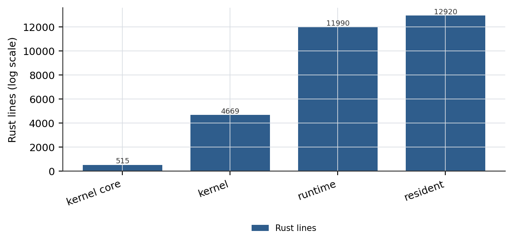
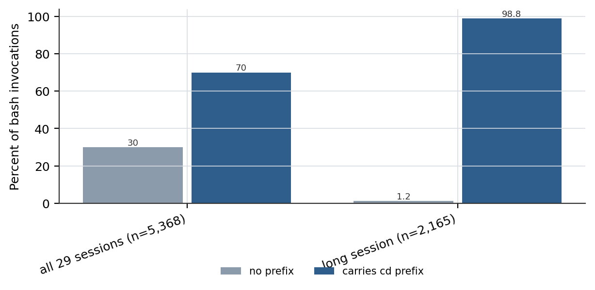

# 冻结地层：以不可变边界治理的分层自我修改

## 摘要

自我改进型 agent 通常以「它可以改什么」来定义。本文研究与之互补的对象：**它不可以改什么**。我们报告一个三层 agent 栈，每一层冻结不同的东西——一个 515 行的内核冻结运行语义，同时为插件开放四档隔离强度；一个 11,990 行的 agent 运行时冻结 ReAct 骨架，同时开放策略变更；一个 12,920 行的居民 agent 冻结内核、裁判与账本，同时开放技能获取。该栈在 51 次提交、8 个版本上运行着一个可用的编码助手，在冻结内核之上应用了 60 条活跃补丁与 77 条退役补丁。三项测量刻画了这一设计。第一，内核与居民的行数比为 1:25（515 行内核支撑 12,920 行居民代码），因此被冻结的表面小到可以作为一个单元整体审计。第二，强制不可变性产生了一种开放自我修改会摧毁的审计信号：四处内核与套件缺陷，其中包括一个被静默串行化的并发域（修前 ≥1.2 秒，修后 0.34 秒）以及一致性测试套件自身的缺口，都是因为下游居民无权向上游打补丁、只能上报才被定位的。第三，一个规格不精确的冻结契约，其代价以模型 token 而非工程师工时支付：跨 29 个会话、5,368 次 bash 调用，其中 3,760 次（70.0%）带有多余的 `cd` 前缀，消耗了全部命令字符的 16.0%；根因是 Windows 扩展长度路径前缀泄漏进 `WORKSPACE_ROOT`，导致 `bash` 静默地在 `C:\Windows` 中执行并返回退出码 0。我们还报告 56.2% 的补丁退役占比，对照既有工作中 48.7% 的 DGM 式变异体丧失基本代码编辑能力；同时我们不声称自己的闸门已在生产中运行过：居民当前的晋升技能数为 0，账本记录为 1 条。但闸门的判定行为可以离线测量——我们把 11 个合成技能目录（9 坏 2 好，每个坏样本只在单一维度上坏）提交给实际部署的晋升入口，得到 11 例中 9 例判定正确：9 个坏样本拦住 8 个，完整基线放行 1 个。这两次漏放本身成为发现：验收段检查会被技能自身的名字喂中，逐案例的证据信号从未被闸门读取。两处均如实报告而未修补，因此本文对闸门的一切正面陈述仅限于「设计意图在 8/9 的坏样本上成立」。请注意，本文不报告任何基准分数，因为本系统未在外部基准上评测；摘要中每一个数字都是可由已发布的 trace 与 git 历史复算的结构性量。本语料覆盖 138 个对话回合、8,900 轮、11,431 次工具调用，计费 229.42M 输入输出 tokens（229.42M tokens），另有 567.45M 缓存读取 tokens，且不训练任何模型，因此训练量为 0 GPU hours。代码、trace 与账本发布于 https://github.com/zh2673-git/rsi-agent。

**关键词**：自修改 agent、不可变边界、插件隔离、agent harness、审计信号

---

## 1 引言

自我改进系统是能够改变自身行为的系统。文献已经就**改什么**收敛出一组富有成效的设计：prompt、agent 脚手架代码、工具库、模型权重，以及在基准压力下修改整个代码库。与之对偶的对象得到的关注要少得多。上述每一个系统同时也包含着它**不**改的东西，而这个选择通常是实现残留，而非明示的架构承诺。DGM 的 archive 维护与父代选择「固定、DGM 不可修改」——论文将其描述为当前实现局限而非安全机制，可造一个不可修改部分只作为未来方向出现。ADAS 由构造冻结了元 agent。AlphaEvolve 把评估器放在进化循环之外。

这种不对称之所以重要，是因为冻结边界不只是限制。它是一项**会改变系统能产出什么信息的结构性承诺**。一个被允许向上游打补丁的下游组件会去打，缺陷因此被就地吸收；一个被禁止向上游打补丁的下游组件必须上报，而这个上报就是关于上游层的一次观测——若没有这条禁令，该观测根本不会存在。我们称之为不可变性的**审计信号性质**，它是本文的核心经验发现：不是设计直觉，而是四处已定位的缺陷（§2.4）。

我们同样清楚不可变性**买不到**什么。近期工作证明，监督者之塔无法让自我修改的安全性变得可验证，而认证需要按设计限制重写、并以一个冻结参照使问题保持良定义。因此我们不作任何安全声明。我们的主张更窄、也更偏架构：冻结一层决定了其上方可用的改进媒介，该媒介决定了改进的维护成本，而冻结本身会发出审计信号。三者皆可测量，我们都测了。

### 1.1 贡献

Our main contribution includes:

本文主要贡献包括：

**设计: 三层冻结地层。**
- 内核层：一套插件语义、四档隔离强度（进程内 / gRPC 进程 / Wasm / 动态库），以 `schema/` 作为线协议的唯一真相源。4,669 行 Rust，其中核心 515 行。
- 运行时层：冻结 ReAct 骨架与工具线协议，策略可变。11,990 行 Rust。
- 居民层：内核、裁判、账本只读，技能资产可写。12,920 行 Rust。
- 内核与居民的行数比为 1:25，因此被冻结的表面可作为整体审计。

**机制: 上报作为缺陷通道。**
- 四处缺陷只因为发现方对缺陷方无权而得定位：两处内核缺陷、一处一致性套件缺口、一处清单漂移。
- 一致性套件缺口是最强的一例，因为审计信号定位的是**审计器自身**的缺陷。

**测量: harness 契约税。**
- Windows 扩展长度路径前缀泄漏进 `WORKSPACE_ROOT`，使 `bash` 静默地在 `C:\Windows` 中执行并返回退出码 0。
- 模型无法察觉，只能无条件补偿：5,368 次 bash 调用中 3,760 次带有冗余 `cd` 前缀（70.0%），消耗全部命令字符的 16.0%。

**记账: 把退役作为一等量。**
- 60 条活跃、77 条退役的外挂补丁，退役占比 56.2%。
- DGM 报告 48.7% 的变异体丧失基本代码编辑能力，该指标度量的是 archive 淘汰，而非退役。

### 1.2 核心评测结果概要

- 内核行数支撑居民行数：**515 : 12,920 = 1 : 25**。
- 可归因于向上上报的缺陷发现数：**4**。
- 5,368 次 bash 调用中的 `cd` 前缀率：**70.0%**，消耗命令字符的 **16.0%**。
- 单会话前缀率峰值：**98.8%**（2,139 / 2,165）。
- 外挂补丁退役占比：**56.2%**（137 条中 77 条）。
- 晋升闸门混淆矩阵：**11 例中 9 例判定正确**（坏样本 9 拦 8，好样本 1 放 1）；并据此定位两处漏放。
- 撰写时的已晋升技能数：**0**；账本工作记录：**1**。

在本文余下部分（In the remainder of this paper），我们首先描述三层冻结地层及其改进媒介 (Section 2)。随后，我们呈现不可变性所产生的审计信号，并对每处缺陷给出机制级归因 (Section 3)。接下来，我们用 harness 契约税的测量来量化不精确契约的代价 (Section 4)。此后，我们描述带类型的 harness 策略及促使它们出现的退化 (Section 5)。然后我们讨论证据分级晋升层，并明确陈述它尚未被真正运行 (Section 6)。我们讨论与既有工作的关系以及我们**不**作的声明 (Section 7)。最后，我们给出结论、报告局限（limitations）并提出未来方向 (Section 8)。

## 2 架构：三层冻结地层

**图 1：三层冻结地层的代码规模（对数刻度）。** 每一层冻结不同的对象、开放不同的改进媒介，因此柱高衡量的不是模块重量，而是每层开放为可写的表面。内核核心 515 行、全量 4,669 行，支撑 12,920 行居民代码，比例为 1:25。

### 2.1 内核层：一套语义，四档隔离强度

内核定义单一的 `Plugin` trait，并接受四种执行域。进程内插件是 Rust trait 对象；进程插件讲 gRPC；Wasm 插件加载沙箱模块；动态库插件被动态装载。设计决策是：**隔离是部署属性，不是语义属性**。插件作者面对一套接口写一份实现，由宿主决定隔离强度。

三条机制保障这一点：

- `schema/` 是线协议的唯一真相源。四种执行域的代码生成皆由它派生，因此语义变更无法只落在一个域上而不触碰共享 schema。
- 生命周期状态机（init → running → draining → destroyed）是内核代码而非插件代码。插件无法观察或跳过中间状态。
- `crates/core` 不含业务逻辑：10 个文件 515 行。这不是风格偏好，而是可审计的不变式——被冻结的表面小到足以整体评审。

这一设计的代价是真实的，我们在 §3.2 报告：跨语言双向流在 guest 侧并不可靠，因为三种运行时对 DATA 帧语义理解不一致，契约最终降级为单向。

### 2.2 运行时层：骨架冻结，策略可变

agent 运行时冻结 ReAct 控制循环及其工具线协议，把策略作为配置开放。线协议在单一模块（`contract.rs`）中规范化，被 Rust、TypeScript 与前端消费者逐字镜像，并由一个一致性测试强制断言每种事件类型的字段存在性。

**表 1：三层冻结地层及其改进媒介。** 行数仅统计 Rust 非空白行，测量于 2026-11-07，锚定 agent-kernel@47b93dc、react-agent@cc9d785、rsi-agent@679f5d3 三个 commit。仅内核核心即为 10 个文件 515 行，故内核行数与居民行数之比为 1:25，整栈的冻结面是其所治理代码的二十五分之一。加粗标示该列最大值，仅便于读数，不表示优劣排序——可写表面大并不比小更好或更差。

| 层 | 可写单元 | 冻结面 | Rust 行数 | 改进媒介 |
|---|---|---|---|---|
| 内核 | 插件 | 一套语义 + 线协议 schema + 生命周期 | **4,669** | 新增插件 |
| 运行时 | 策略 / 工具接线 | ReAct 骨架 + 工具线协议 | **11,990** | 树外补丁 |
| 居民 | 技能资产 | 内核 + 裁判 + 账本 | **12,920** | 新建技能目录 |

### 2.3 居民层：内核、裁判与账本只读

居民 agent 可以写技能，不可以写内核、裁判与账本。强制是机械的：写入受保护子树会触发 `CORE_PROTECTED` 并被拒绝。本文覆盖的开发期内，该护栏实际触发 5 次。我们报告这个数字，因为它是我们拥有的、证明该边界承重而非纯文档的唯一直接证据。

该边界之上可用的改进媒介是技能资产。技能是带 `SKILL.md` 清单与可选 `tools.json` 的目录，在**下一个**对话回合加载，而非当前回合。这一轮的滞后是刻意约束：它阻止一个技能去影响那个将要安装它的评测。

### 2.4 讨论：冻结决定了什么

三层并非彼此独立的选择。内核冻结决定了运行时的改进媒介是**策略与工具接线**而非语义。运行时冻结决定了居民的媒介是**资产**而非控制流。每种媒介都有其特征维护成本，而这些成本相差约一个数量级：一次策略变更是配置 diff，一次工具接线变更是外挂补丁，一次资产变更是新建目录。

## 3 不可变性所产生的审计信号

### 3.1 机制

因为居民无法给内核或运行时打补丁，两层中任何一层的缺陷都必须上报。上报携带归因链，因为居民必须先定位故障、才能判定故障不在自己身上。这与「自我修改 agent 哪里坏了就补哪里」的系统正好相反：在那种系统里，「这是我们的 bug」与「这是他们的 bug」之间的界线，在打补丁的那一刻就消失了。

我们必须明确区分本文与「朴素的审计转发层不可靠」这一结论。*Audit Without Verification* 测量了一条 6 agent 管线，发现在给定各 agent 自行提交的报告时，审计者只在 4.1% 的情况下找回了真实故障源，误伤无辜方比例为 34.4% / 62.6%。我们的设定在一个结构性方面不同：我们的 agent 对上游层**完全没有**修改权限，所以「补掉它然后继续」这条退路并不存在，上报伴随的是复现而非叙述。

### 3.2 四处已定位的缺陷

**D1 —— 内核 v0.1.1 `destroy` 竞态。** 生命周期状态机可能在一个 dispatch 尚未完成时拆掉插件。由下游端到端测试发现，而非内核单元测试发现。上游在 v0.1.1 修复。

**D2 —— 内核 v0.1.2 静默串行化的并发域。** `Process` 域在契约中声明 `Concurrent`，但宿主代理持有一把锁，插件级并发语义因此被无声作废。由 K502 雪崩归因发现：一个下游任务超时，向上追溯超时原因，定位到并发声明未被兑现。修前实测 dispatch 时延 ≥1.2 秒，修后 0.34 秒。这是审计信号性质最干净的一例，因为该缺陷从宿主内部是不可见的——宿主对自己的锁而言行为正确，被违背的只是**声明**的契约。

**D3 —— 一致性套件缺口。** 一致性套件没有测试某个契约字段，而第二个居民（mini-agent）恰好依赖该字段。套件自身的缺口因为引入第二个居民而暴露；源码注释明确记录了这一来历。这是该性质的最强形式：审计信号定位的是**审计器**的缺陷。

**D4 —— 居民清单漂移。** 两个居民相对 `RESIDENTS.md` 的声明能力出现分歧，进而需要一份例行保养清单。

共同结构：每一例中，发现方对缺陷方都无权限，且缺陷都在**声明**而非实现上。声明对实现者的单元测试不可见，而对其消费者的集成可见。

### 3.3 讨论

我们不声称这一机制是免费的。它消耗时延：居民无法修复阻塞自己的 bug，修复要等上游发版。它也消耗规格撰写成本：边界必须被表达到足够精确，违约才可检测（§4 展示的正是表达不精确时会发生什么）。

## 4 Harness 契约税：当冻结契约的规格不精确

### 4.1 缺陷

在 Windows 上，`std::fs::canonicalize()` 返回带扩展长度前缀 `\\?\` 的路径。宿主直接用 `ws.canonicalize()` 的结果设置子进程的工作区环境（`instances.rs:171`）。代码库对此前缀是知情的——`remember_workspace` 显式剥除它，注释里写明了原因（`instances.rs:44-46`）——但剥除没有应用在 spawn 处。后果，用修复提交的原话说：`bash` 在 `\\?\` 前缀工作区下**静默地改在 `C:\Windows` 执行并返回退出码 0**。

这一失败是三重静默的：工作目录错了；命令仍可能在错误目录下成功；退出码说成功。一个不静态知晓工作区路径的模型无法察觉它。`SilentProbe` 在 API 层面发现了同类问题——12 个模型检出静默失败的比率为 12%，修复率为 0%，对用户断言假结果的比率为 41%。我们的观察与之一致，并解释了其行为响应：**正因为模型检不出这个失败，它才选择无条件补偿。**

### 4.2 测量

我们扫描了全部 29 个会话 trace（20,041,120 字符的模型可见载荷），识别每一次命令以 `cd` 前缀起始的 `bash` 工具调用。

**表 2：全部 29 个会话 trace 上的 harness 契约税。** 命令以指向显式路径的 `cd` 起始即计为带前缀。字符占比为前缀字符与命令总字符之比；未施加分词器，故 token 成本至少与字符占比相当。失败计数为下界，因为静默成功在 trace 中不可见。

| 量 | 值 |
|---|---|
| 扫描会话数 | 29 |
| 模型可见 trace 载荷 | 20,041,120 字符 |
| bash 调用次数 | 5,368 |
| 带 cd 前缀 | 3,760（70.0%） |
| 前缀字符 | 201,868 |
| 命令总字符 | 1,261,369 |
| 前缀字符占比 | 16.0% |
| 单会话峰值前缀率 | 98.8%（2,139 / 2,165） |
| 无前缀调用 | 1,608 |
| 无前缀调用失败 | 100（6.2%，下界） |

**图 2：跨会话的 harness 契约税。** 左侧为全部 29 个会话的聚合，右侧为观测到的最高前缀率的长程会话。一条命令带有多余的 `cd` 前缀（用于补偿静默丢失的工作目录）即计入「付税」。补偿并非边缘量：全部调用中 70.0%、最长会话中 98.8% 的调用都在付税，消耗全部命令字符的 16.0%。

补偿不是边缘性的。在 5,368 次调用中，3,760 次（70.0%）带有前缀，前缀消耗全部命令字符的 16.0%。分布呈双峰而非均匀：模型在工作区内工作的会话位于 70–99%，而只读绝对路径的会话接近 0%。

我们还测量了补偿必要性的分母：1,608 次无前缀调用中，100 次（6.2%）失败。这个 6.2% 是底层失败率的下界，因为静默成功在 trace 中不可见。

### 4.3 讨论：成本转移，而非质量缺陷

既有文献把静默失败当作质量问题——一份待枚举、待消除的分类清单（*Silent Failures in Agent-Tool Interaction* 在 15 个工具上枚举了 91 个已验证案例）。我们把同一现象当作**成本核算**问题。环境没有履约；绕行方案的代价不出现在环境的预算里，而出现在模型的 token 预算里。二者由不同主体支付。

我们不声称 harness 成本这一发现本身是新的：*What Does a Harness Buy? Tokens, Mostly* 已经确立，在模型固定的前提下，每任务成本跨 harness 最多相差 3 倍，且差距由 system prompt 与 tool schema 前导设定。我们的贡献更窄：当差距源于**契约违约**而非设计选择时，它可以被归因到具体缺陷、表达为一种补偿类型，并以字符计量。

## 5 带类型的 Harness 策略

运行时最初把墙钟预算与 token 预算走同一条硬中止路径。我们观察到，这两者不是同一类约束。token 预算是**成本闸**：停下来就是目的，为把一句话说完再花一次钱恰恰违背目的。墙钟截止是**时长护栏**：其目的是给失控的长跑设界，而不是惩罚那些本就耗时长久的任务。

把两者混为一谈，意味着护栏被体验为处罚。在原实现中，截止时间到点会丢弃本轮全部工具结果、全部思考步骤与已生成的部分答案，只返回一个错误气泡。任务没做完，工作也没了。

修复方案给停止原因加了类型：

- `StopReason::Tokens` —— 硬停止，成本闸，不再发起 LLM 调用。
- `StopReason::Deadline` —— 软收敛：循环进入强制收尾轮，交出一份部分成果，并明确写出已完成什么、尚缺什么。

同类问题在上下文压缩中再次出现。设计规定双闸（条数**或**估算 token）；实现只接了条数闸。配合 `keep=194` 超过 `trigger=40` 的配置，压缩产出 `split=8`：几乎每轮都触发、几乎什么都没保留、也几乎什么都没压掉。加入阈值约束、补齐闸门后，第一次真正的压缩摘掉了 603 条消息。

我们把局限讲清楚：我们有机制和诊断，但没有配对实验。我们不报告硬中止与软收敛之间的成果留存率对比，因为我们没做。

## 6 证据分级晋升

居民的晋升路径分离了三种角色：改动的生产者不打分，裁判没有写权限，晋升器是一个规则引擎，只在证据等级足以支撑该改动类别时才放行。同一模型自评永远不构成晋升依据。触及工具或内核的技能额外需要人工授权。

我们不做修饰地陈述现状。撰写之时，居民的**已晋升技能为 0 个**，账本含 **1 条**工作记录。真实晋升从未发生，因此凡关于闸门**生产行为**的句子都只能用 `we design` 或 `we implement`。

但闸门的**判定行为**无需真实晋升即可直接测量，因为晋升是目录状态的纯函数。据此我们跑了一个离线混淆矩阵：九个故意造坏的技能目录与两个结构完整的目录，每个坏样本只在与基线不同的一个维度上坏，提交给真实入口 `skill_state.promote()`，且账本重定向到临时目录，使任何测试记录都无法污染生产账本 [E-GATE-02]。判定逻辑一行未改，被测对象就是实际部署的闸门。

表 3 报告结果。九个坏样本中八个被拒；唯一的完整基线被放行。两个错误并不对称，我们把它们作为对**自身实现**的发现来报告，而非作为证据闸门的普遍性质。

**发现一：验收段检查被技能自身的名字喂中。** 一个完全没有验收段的技能，只要其名字或标题含有 `acceptance`、`success criteria` 或对应中文，就能通过 `skill_validate --mode full`——因为该检查在整篇文档里搜索这些关键词，而 H1 标题行正好提供了一次命中。同一份坏文件改用一个中性名字后，被正确拒绝并报 `E_ACCEPTANCE_MISSING`；两个样本唯一的差别就是名字。检查是**对全文**提问，而非对某一节提问，于是一个名字就能满足一条结构要求。

**发现二：闸门查不到逐案例的证据信号。** 我们的政策要求晋升建立在 E1/E2/E3 外部信号之上，且同模型自评永不构成依据。实现只在命令行上守住了前半句：`promote --signal E2` 会对照白名单校验，而 `evals/cases.jsonl` 里每条案例的 `signal` 字段从未被读取。一个三条案例全为 `judge`（仅审计型、非确定性证据）的目录被成功晋升。闸门校验的是**声称的**等级，而不是**记录的**等级。

两处发现形状相同：检查的意图正确，但提问的对象错了——用文档全文代替了章节结构，用命令行参数代替了证据文件。这两处从政策文档上都看不出来，这正是我们把矩阵视为闸门实际规格的原因。我们**没有**修补任一缺陷；表 3 的数字是未修补行为，我们报告它，因为一个失败未被记录的闸门，与一个没有失败的闸门无法区分。

**表 3：晋升闸门在 11 个合成技能目录上的混淆矩阵。** 每个坏样本与完整基线只在一个维度上不同，因此一次拒绝可归因于该维度。判定由实际部署的 `skill_state.promote()` 入口产出，账本重定向至临时目录；测试未重写任何判定逻辑，故被测对象是已部署闸门而非其复述。表中「期望」是 `policies/promotion.md` 写明的设计意图，「实测」是实现的实际行为。加粗仅标示两处漏放，不代表任何性能排名——本表没有任何一列沿质量轴变化。

| 样本 | 破坏维度 | 期望 | 实测 | 错误码 |
|---|---|---|---|---|
| good-baseline | —（对照） | allow | allow | — |
| good-tools-no-human | 有 tools.json 但无 --human | block | block | E_TOOLS_HUMAN |
| bad-no-frontmatter | 缺 frontmatter | block | block | E_VALIDATE |
| bad-dir-name-mismatch | 目录名 ≠ name | block | block | E_VALIDATE |
| bad-no-accept-seg | 无验收段 | block | block | E_ACCEPTANCE_MISSING |
| probe-name-acceptance | 无验收段，但名字含该词 | block | **allow** | — |
| bad-cases-missing | 无 cases.jsonl | block | block | E_VALIDATE |
| bad-eval-missing | 无 scorecard | block | block | E_EVAL_MISSING |
| bad-low-score | pass_rate 0.33 < 0.80 | block | block | E_EVAL_GATE |
| bad-regression | 旧案例退化 | block | block | E_EVAL_GATE |
| bad-self-eval-only | 全部案例 signal=judge | block | **allow** | — |

坏样本：9 拦 8。好样本：1 放行、1 因缺人工授权被正确暂扣。`bad-low-score` 行的 0.33 是合成 scorecard 的 `pass_rate` 字段值，不是任何实测模型分数 [E-GATE-02, E-GATE-03]。

## 7 与既有工作的定位

**自我修改的对象。** DGM 在基准压力下修改自己的代码库，报告 SWE-bench Verified 从 20.0% 提升到 50.0%；其 archive 维护与父代选择是固定的，但被描述为局限，不可修改子系统只作为未来方向出现。Gödel Agent 递归重写其策略与元学习算法两者。ADAS 冻结元 agent。AlphaEvolve 把评估器置于循环之外。我们沿用「修改对象是首要设计轴」这一框架，差异在于把**非对象**当作设计对象。

**不可变性与安全。** 我们不声称我们的边界使系统安全。Unfireable Safety Kernel 达到外部授权内核的形式化验证，针对内核的 704 次自我修改全部被拒；Algorithmic Unverifiability 证明监督者之塔无法解决一般问题，而是一个冻结参照让问题保持良定义。我们的边界是工程边界，它们让缺陷可观测，代价是修复时延。

**评测信号。** HGM 观察到基准分数不等同于元生产力，DGM 也承认在其设定下基准分数与自我修改能力同构。这正是我们不用基准分数作为自我改进证据的原因，我们改为报告结构性量（比例、退役占比、缺陷归因链）。

**Harness 成本。** *What Does a Harness Buy? Tokens, Mostly* 表明在模型固定时 harness 选择可让成本移动最多 3 倍。我们在其上构建，差异在于把其中特定的一片成本归因于契约违约而非设计选择，代价是测量面窄得多（单一平台、单一工具、单一缺陷类别）。

**成本核算口径。** 请注意，上述成本（the aforementioned costs include only）只包含在 trace 语料上测得的命令字符串字符；它不含工具输出、system prompt 与每次调用的额外开销，也未折算为 token 或货币。因此 16.0% 的前缀占比是真实 token 占比的下界，因为在字节对编码下，路径字符串的每字符分词数高于散文。

**审计。** *Audit Without Verification* 表明基于转发的缺陷归因会失效，仅在 4.1% 的情况下找回真实源头。与那项设定不同，我们的 agent 没有向上写权限，因此上报是被迫的，并且伴随复现。

## 8 结论、局限与未来方向（Conclusion, Limitations, and Future Directions）

本文呈现一个三层 agent 栈，每层冻结不同对象：515 行内核承载一套插件语义跨四档隔离强度；11,990 行承载冻结骨架与可变策略；12,920 行承载只读内核、裁判、账本与可写资产。我们报告 1:25 的内核与居民行数比、四处仅因向上上报而被定位的缺陷、5,368 次 bash 调用上 70.0% 的补偿率（消耗 16.0% 命令字符），以及 137 条外挂补丁上 56.2% 的退役占比。

在承认该架构自洽、测量可由仓库内脚本在 trace 语料上复现的同时，我们也认识到本工作有实质局限。首先，改进闭环尚未在时间上收敛：居民未晋升任何技能，账本仅一条记录，因此关于自我改进的每一句主张都是关于一个已设计并已实现的机制的主张，而非关于一条被观测到的轨迹。其次，全部测量来自单机、单用户、单一操作系统，无多 seed，且 70.0% 的补偿率是某一平台特定缺陷的属性，而非普适常数。第三，§6 的混淆矩阵暴露了我们自己闸门的两处漏放（名称喂中验收检查、案例信号未被读取），我们如实报告而**未修补**：这意味着本文对闸门的所有正面陈述都限于「设计意图在 8/9 的坏样本上成立」，不能读作「闸门可靠」。样本是合成的最小技能，不是真实用户技能，因此该矩阵刻画的是判定逻辑的形态，不是它在真实技能分布上的错误率。所幸前两条局限属更长部署可以化解的类型，而不属于需要另做设计的类型。

未来我们计划在以下方向投入。

- ~~对一批注入的、含缺陷与健全的技能候选运行证据闸门~~（已完成，见 §6 与表 3：11 例中 9 例判定正确，并据此发现两处漏放）。
- 修补 §6 发现的两处漏放：把验收检查从「全文搜索」收窄为「章节结构」，并让 `promote` 读取 `evals/cases.jsonl` 的逐案例 `signal` 而非仅信任命令行参数；修补后按同一矩阵回归，使漏放数从 2 降到 0。
- 对同一插件运行全部四档隔离强度，报告吞吐、启动与内存的代价曲线，使隔离强度成为可预算的选择而非可用的选项。
- 在匹配的任务与预算下运行硬中止与软收敛的配对对比，报告成果留存率。
- 将 trace 与账本扩展到第二、第三个居民，使审计信号性质在多于两个消费者的情况下被观测。

## 附录 A 贡献与致谢

本工作以单开发者模式完成，agent 是主要实现方。agent 撰写的代码已在仓库历史中标识。我们感谢那些为第 7 节提供对照点的开源 agent 设计。

## 附录 B 测量流程

**`cd` 前缀的 trace 扫描（E-HARNESS-01/02/03/04）。** 逐行读取匹配 `runtime/plugins/memory/data/traces/*.jsonl` 的每个文件。收集 `type == "tool_call"` 且 `name == "bash"` 的行；命令取 `args.command`。若命令匹配 `^\s*cd\s+(/d\s+)?("[^"]*"|\S+)\s*(&&|&)\s*`，计为带前缀。字符计数使用原始命令字符串长度，不套用分词器。

**保真度分层（E-FIDELITY-01/02/03/04）。** 以 trace 为模型可见地面的真相；对每一行累加 `text`、`result_truncated`、`answer`、`reasoning` 的长度以及 `args` 的 JSON 序列化长度。事件侧累加 `preview` 与 `summary`。比值以 事件/轨迹 报告。

**退役记账（E-PATCH-01/02）。** 活跃补丁为 `scripts/patches` 下直接存放的 `*.json` 加上 `scripts/patches/q-round` 下的 `*.json`。退役补丁为 `scripts/patches/retired` 下的 `*.json` 加上被改名为 `*.json.retired` 的文件。退役占比 = 退役 /（退役 + 活跃）。

## 附录 C 完整表格

表 1–2 见正文。测量由两个随仓库提交的脚本算出：`scripts/e3_harness_tax.py` 与 `scripts/e7_fidelity.py`，两者都支持 `--paper` 参数固定切点，因此本文数字无需联网即可复现。`skills/trace-analysis/` 提供分析期使用的交互式查询。
