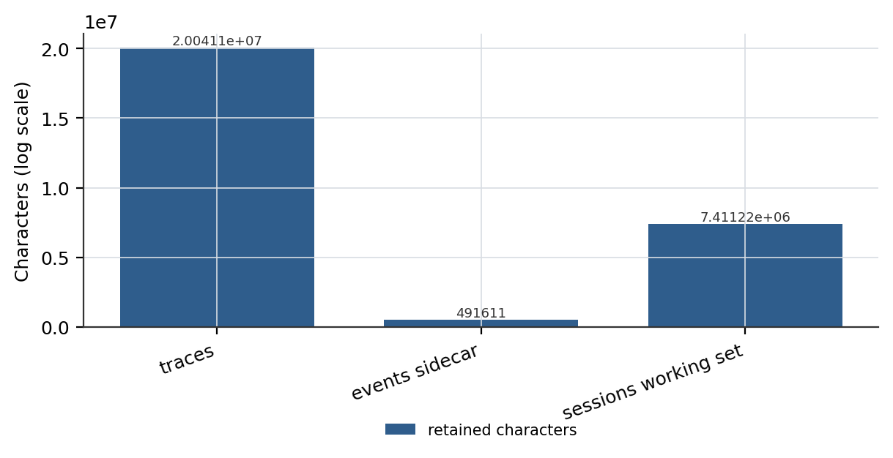

# The Reconstructibility Gap: Auditing Lossy Compaction in Long-Lived Agent Sessions

## Abstract

Agent memory systems increasingly claim that an append-only log is the source of truth and that the model-visible context is a derived view. We show that this claim is untested where it matters most: after lossy compaction. We define the reconstructibility gap as the difference between what a session log records and what is needed to rebuild the exact model-visible context that existed immediately before a compaction event, and we turn it into a family of executable assertions rather than a design claim. We then measure the gap on a deployed coding agent: across 29 sessions and 20,041,120 characters of model-visible payload, the append-only sidecar retains 491,611 characters, a fidelity of 2.45 percent. The sidecar is missing every field required for reconstruction — original message content is stored only as a 200-character preview, tool-call arguments and tool-result bodies are absent, and messages carry no stable sequence identifier — while the compaction events themselves are complete, each recording the deleted range as `first_kept`, the retained count as `kept`, and the pre-compaction size as `tokens_before`. The system therefore knows exactly which messages it forgot and cannot recover any of them. We report 15 compaction events and 1 rollback event across the corpus, a worst-case compression of 761,547 characters into a 1,764-character summary, and 2,223 tool results marked `memory_truncated` before entering the model context. We state the claim narrowly: we propose a reconstruction contract, we measure one system against it, and we do not benchmark multiple systems. The measurement is recomputable from the project's own trace corpus without network access via two scripts committed alongside this paper, and it requires 0 GPU hours of training because no model is trained. The corpus itself is not published: it contains this project's working sessions. What is released is the code — `scripts/e7_fidelity.py --paper` and `scripts/e3_harness_tax.py --paper` at https://github.com/zh2673-git/rsi-agent.

**Keywords**: context management, lossy compaction, session audit, event sourcing, agent memory

---

## 1 Introduction

Long-lived agents compress their context. The compression is lossy, and recent work has made the loss explicit: iterative rewriting erodes details over time, and summarization preferentially discards domain insight in favour of brevity [ACE]. Systems that acknowledge this have moved in two directions. One direction makes the compression incremental so that erosion is slowed [ACE]. The other keeps the original entries and inserts a summary entry without deleting what came before, so that the model sees an active branch and the storage retains the whole tree [pi].

Neither direction answers the question we ask here. If a log retains everything and compaction inserts a summary, then a system *should* be able to rebuild the context that existed before the compaction. Whether it actually can is an empirical question about fields, indexes, and identifiers — not about intent. We find that the question is rarely asked, and that in a deployed system the answer is no.

Our contribution is to make the question precise enough to fail. We define a reconstruction contract: given a session log and a compaction event, a system satisfies the contract when it can materialize the exact sequence of messages that was model-visible immediately before that event. We decompose the contract into five field-level requirements, show which of them a deployed system satisfies, and report the measured fidelity shortfall.

This is a narrower contribution than it may first appear, and we are careful about it. Append-only logs as the source of truth with deterministic replay are already argued and implemented [ActiveGraph], and typed event logs supporting fork and time travel are already engineering practice [pi, LangGraph]. Replay has already been decomposed into a family of falsifiable assertions and tested on 5,540 public runtime logs [2611.06924]. What has not been done is the intersection: **strict reconstruction across a lossy compaction boundary**. ActiveGraph explicitly has no compaction and replays a million-event run in full. The replay-assertion work does not address compaction. The compaction literature quantifies loss but proposes no reconstruction acceptance criterion.

### 1.1 Contributions

Our main contribution includes:

**A contract: reconstructibility as five field-level requirements.**
- Original message content must be recoverable, not projected.
- Tool-call arguments must be retained.
- Tool-result bodies must be retained.
- Messages must carry stable ordering identifiers.
- The deleted range must be addressable from the compaction event.

**A measurement: the gap on a deployed system.**
- Sidecar fidelity is 2.45% of the model-visible payload: 491,611 of 20,041,120 characters.
- Four of the five requirements are violated; only range addressability holds.
- The system records 15 compactions and 1 rollback, and knows the exact boundaries of everything it discarded.

**A distinction: knowing what was lost is not the same as being able to recover it.**
- Compaction events are field-complete (`first_kept`, `kept`, `tokens_before`, `summary`).
- The retained content is a 200-character preview with no argument or result payload.
- The worst compression observed is 761,547 characters into 1,764.

**A diagnostic: truncation is instrumented but unaccounted.**
- 2,223 tool results carry `memory_truncated=true` before entering context; in one session 230 of 1,609 tool results (14.3%) are truncated.
- The marker exists, so the loss is observable; no consumer reads it, so the loss is not accounted.

### 1.2 Summary of Core Evaluation Results

- Sidecar fidelity against model-visible traces: **2.45%** (491,611 / 20,041,120 characters).
- Reconstruction requirements satisfied: **1 of 5**.
- Compaction events / rollback events: **15 / 1**.
- Worst compression ratio: **761,547 : 1,764 ≈ 432 : 1**.
- Tool results truncated before entering context: **2,223** of 13,344 (16.7%); peak single session **14.3%**.
- Sessions scanned / chat turns / tool calls: **29 / 138 / 11,431**.

In the remainder of this paper, we first formalize the reconstruction contract and position it against existing log-based and compaction-based designs (Section 2). Subsequently, we present the system under study and the three persistence layers it exposes (Section 3). Next, we report the measurement, including the per-field violation table and the compression statistics (Section 4). Thereafter, we analyse why the gap persists, tracing it to a projection decision made at write time (Section 5). We then discuss related work and the specific claims we do not make (Section 6). Lastly, we conclude, report limitations, and propose the experiments that would turn this single-system measurement into a benchmark (Section 7).

## 2 Approach: The Reconstruction Contract

### 2.1 Definition

Let a session log be a sequence of events `E = e_1 … e_n`, and let `c` be a compaction event at index `k`. Define `visible(i)` as the sequence of messages the model received at turn `i`. The reconstruction contract holds at `c` if and only if there exists a function `R` such that `R(E[1..k], c) = visible(k-1)` byte for byte.

We make the contract operational by decomposing it. `R` is implementable if and only if the log contains, for every message in `visible(k-1)`:

1. **Content**: the message body in full, not a projection, prefix, or summary.
2. **Arguments**: for assistant messages carrying tool calls, the full argument payload.
3. **Results**: for tool messages, the full result body as the model received it.
4. **Order**: a stable identifier sufficient to reconstruct sequence without relying on file position.
5. **Range**: from `c` alone, the ability to address which messages were discarded and which were retained.

Requirements 1–3 are about payload, 4 about ordering, 5 about addressability. A system can satisfy 5 while violating 1–3, and that is precisely the failure mode we measure: it can point at what it lost.

### 2.2 Why the Contract Is Not Implied by Existing Claims

Three existing positions look adjacent but do not imply the contract.

**Log-as-truth-source.** *The Log is the Agent* argues that an append-only event log should be the sole source of truth, with the working graph as its deterministic projection, and that provenance is total and replay exact [ActiveGraph]. This is a stronger claim than ours about *provenance* and a weaker one about *compaction*: the same work states that it provides no compaction or checkpointing, so a million-event run is replayed in full. Our contract only becomes non-trivial once compaction exists, because without compaction there is nothing to reconstruct that the full replay does not already contain.

**Tree-with-summary-entry.** pi persists sessions as a JSONL tree, inserts a `compaction` entry carrying `summary`, `firstKeptEntryId`, `tokensBefore`, and `systemMessage`, states that compaction does not delete original entries, and reconstructs model context from the active branch [pi]. This is the closest engineering form to our contract, and it satisfies requirement 5 by construction. It is documented but, to our reading, neither formalized as a contract nor accompanied by a quantitative acceptance test. We adopt its structural insight — keep the entries, insert the summary — and differ by asking whether the reconstruction actually reproduces the pre-compaction bytes, at the cost of not being able to claim the structure itself.

**Replay as a family of assertions.** Recent work decomposes replay, cheap fork, and lineage into separately falsifiable assertions and tests them over 5,540 public runtime logs and 317,296 projection cuts [2611.06924]. That work establishes that "replay works" is not one claim but many, and it supplies the methodological stance we adopt. It does not address the compaction boundary; indeed it observes that many cuts sever a model request such that continuation is not licensed, 36,251 of 317,296 — which is exactly the phenomenon a compaction boundary creates deliberately.

**Compaction loss quantification.** Studies of parallel compaction show that summarization is inherently lossy and that retained content varies unpredictably run to run [ParallelCompaction]. A survey of context compression proposes a failure taxonomy (decision error before compression, information loss during, access failure after) and a `Recover` operator, but no reconstruction acceptance protocol [CompressionSurvey]. E-mem avoids lossy compression entirely by holding uncompressed contexts and reconstructing semantically at use time [Emem], which is a different guarantee: semantic reconstruction does not promise the same bytes.

We therefore locate the contribution at the intersection: a contract, a per-field violation table, and a measurement, on a system that has compaction.

### 2.3 Discussion: What the Contract Costs

Satisfying the contract is not free, and we are honest about the trade. Retaining full payloads means the log grows without bound unless a separate retention policy exists; the deployed system chose a projection precisely to keep the sidecar small. Requirement 4 (stable ordering identifiers) forces a schema decision that is hard to retrofit, since file position is the tempting default. Requirement 1 (full content) conflicts with the privacy motivation for projecting payloads. Any benchmark built on this contract must therefore report the log-size multiplier alongside the fidelity number, or it will reward systems that simply store everything.

## 3 The System Under Study

### 3.1 Three Persistence Layers

The system exposes three layers with different fidelity, and the distinction between them is the object of study.

- **Traces** (`traces/<id>.jsonl`): one row per event, including every tool call with its arguments and every tool result with its body, both marked with truncation flags. This is the model-visible ground truth for our measurement.
- **Events** (`events/<id>.jsonl`): an append-only sidecar written by the memory plugin. Every message is recorded as `{ts, kind, role, preview}` where `preview` is the content sliced to 200 characters. Compaction and rollback are recorded as typed events with structured fields.
- **Sessions** (`sessions/<id>.json`): the working set, replaced in place on compaction. This is what the model actually receives on the next turn.

The design intent, stated in the source, is that the sidecar makes the original text survive compaction: `sessions/<id>.json` remains the only view of the model's working set while every original message, summary, and trace event is appended to `events/<id>.jsonl`, so that original text is never deleted by compaction. The measurement in Section 4 shows that what actually survives is a prefix, not the original.

### 3.2 What Compaction Records

The compaction event is well-formed. Each of the 15 events carries `kind`, `ts`, `summary`, `first_kept`, `kept`, and `tokens_before`. The system therefore has a precise account of every compaction it performed. Table 1 lists the nine events from the most active session.

**Table 1: The nine compaction events recorded in the most active session.** Each event carries kind, ts, summary, first_kept, kept, and tokens_before, so the system has a precise account of every compaction it performed. tokens_before is the serialized length of the pre-compaction message array as the system computed it, not a model tokenizer count. The worst case compresses 761,547 characters into a 1,764-character summary, a ratio of roughly 432 to 1. Bold marks the largest tokens_before and underline marks the shortest summary, for readability only.

| # | tokens_before | kept | first_kept | summary chars | ratio |
|---|---|---|---|---|---|
| 1 | **761,547** | 30 | 604 | <u>1,764</u> | 432:1 |
| 2 | **271,480** | 30 | 110 | <u>1,033</u> | 263:1 |
| 3 | **95,869** | 30 | 49 | <u>847</u> | 113:1 |
| 4 | **270,225** | 30 | 169 | <u>2,154</u> | 125:1 |
| 5 | **170,492** | 30 | 151 | <u>1,369</u> | 125:1 |
| 6 | **63,790** | 30 | 19 | <u>1,035</u> | 62:1 |
| 7 | **167,239** | 30 | 145 | <u>1,450</u> | 115:1 |
| 8 | **238,393** | 29 | 219 | <u>1,238</u> | 193:1 |
| 9 | **65,962** | 29 | 35 | <u>1,354</u> | 49:1 |

### 3.3 What Compaction Destroys

The model is told, in the marker message returned by the compaction routine, that the prior history has been compressed into a summary and that it should continue from that summary and not claim to remember the compressed original. That instruction is the only compensation mechanism. There is no code path that reconstructs anything from the sidecar, and Section 4 shows that none could.

**Figure 1:** Payload retained by each persistence layer, on a logarithmic scale. Traces hold the model-visible ground truth, the sidecar holds a 200-character projection of each message, and sessions hold the post-compaction working set. The sidecar retains 2.45 percent of the trace payload, a shortfall of two orders of magnitude that is structural rather than statistical because content is projected at write time.

## 4 Evaluations

### 4.1 Setup

We scan all 29 trace files, all 8 event sidecars, and all 28 session files present in the deployed data directory, at a single cut point (2026-11-07T13:35:24 local, filtered on each row's `ts`) so that no two quantities are sampled at different moments. Traces are treated as ground truth. For traces we accumulate the length of `text`, `result_truncated`, `answer`, `reasoning`, and the JSON serialization of `args`. For events we accumulate `preview` and `summary`. For sessions we read the message array. No network access is required and no model is called, so the evaluation cost is 0 GPU hours and 0 tokens.

### 4.2 Fidelity

**Table 2: Fidelity of the three persistence layers against model-visible traces.** Traces are treated as ground truth and include every tool call with arguments and every tool result with body. The sidecar retains 2.45 percent of the trace payload, a shortfall of two orders of magnitude. Character counts are exact; no tokenizer is applied, so token-level fidelity is not reported. The sessions row is not a retention figure: the working set is rewritten at every compaction and is listed only to show that it holds 37.0 percent of the trace payload without being an independent copy of the original.

| Layer | File pattern | Characters | Share of traces | Role |
|---|---|---|---|---|
| traces | traces/<id>.jsonl | 20,041,120 | **100.0%** | ground truth |
| events | events/<id>.jsonl | 491,611 | **2.45%** | audit index |
| sessions | sessions/<id>.json | 7,411,221 | **37.0%** | working set |

The sidecar retains 2.45% of the model-visible payload (Table 2). The number is not a rounding artifact: two orders of magnitude separate the two quantities, and the shortfall is structural rather than statistical, as the next subsection shows.

### 4.3 Per-Field Violation

**Table 3: The five field-level reconstruction requirements and their status on the deployed system.** Four of five requirements are violated. The sidecar satisfies range addressability and nothing else, which is the precise sense in which the system knows what it lost: first_kept is recorded exactly while the discarded content is unavailable. Requirement status is determined by inspection of the write path, not by attempting reconstruction, because reconstruction is provably impossible once content is projected at write time.

| # | Requirement | What reconstruction needs | Status | Observed |
|---|---|---|---|---|
| 1 | Content | full message body | VIOLATED | `slice(0, 200)` preview |
| 2 | Arguments | full tool-call payload | VIOLATED | field absent |
| 3 | Results | full tool-result body | VIOLATED | field absent |
| 4 | Order | stable sequence identifier | VIOLATED | file position only |
| 5 | Range | deleted range addressable | SATISFIED | `first_kept`, `kept` |

Four of five requirements are violated. The sidecar satisfies range addressability and nothing else. This is the specific sense in which the system "knows what it lost": `first_kept` is recorded exactly, and the discarded content is unavailable.

### 4.4 Compression Statistics

The nine compactions in the most active session give the distribution. `tokens_before` ranges from 63,790 to 761,547. Summaries range from 847 to 2,154 characters. The worst case compresses 761,547 characters into 1,764, a ratio of roughly 432:1. One event records `first_kept=110` with `kept=30`, a configuration in which the range the gate intended to delete and the count it intended to keep disagree — consistent with the threshold-constraint defect reported in the companion work.

We also measured truncation that happens before compaction, at the tool boundary: 2,223 of 13,344 tool results carry `memory_truncated=true`. In the most active session, 230 of 1,609 tool results (14.3%) are truncated. Every one of those rows retains exactly 2,000 characters, so the retained volume is a flat function of the row count: 4,446,000 characters. The marker exists and is machine-readable; it is a fully instrumented loss. Nothing reads it, so the loss is recorded but never accounted.

### 4.5 Discussion

Two observations follow. First, instrumenting a loss and accounting for a loss are different engineering acts. This system does the first and not the second, which suggests the gap is not an oversight in one code path but a missing consumer for a signal that was correctly produced. Second, range addressability is the easy half of the contract. Knowing which messages were deleted requires one integer; recovering them requires that the payload was never projected. Systems will tend to satisfy the cheap half and report it as if it were the whole.

## 5 Analysis: Why the Gap Persists

The gap traces to a single decision at write time. The memory plugin appends `preview: (m.content ?? "").slice(0, 200)` for each incoming message. Given that projection, no downstream reconstruction is possible regardless of how the log is later indexed, replayed, or queried. The decision is defensible in isolation — a full-payload sidecar duplicates the working set and grows without bound — but it is incompatible with the stated goal, and nothing in the system enforces consistency between the goal and the write path.

Three properties of the situation generalize.

- The failure is silent at the schema level. `preview` is a required field, so every consumer that reads the sidecar succeeds; none of them notices that the field name describes a projection rather than content.
- The failure is invisible to tests that check event presence. A conformance test asserting that a `message` event has `kind`, `role`, and `preview` passes on a system that has lost the ability to reconstruct anything.
- The failure survives because the compensation is a prompt instruction. Telling the model not to claim it remembers the compressed original converts an engineering gap into a behavioural constraint on the model, which is precisely the substitution this paper argues against.

## 6 Positioning Against Prior Work

**Context management.** ACE names and measures the two failure modes we build on: brevity bias, where iterative rewriting drops domain insight for concision, and context collapse, where rewriting erodes detail across rounds, with a reported instance going from 18,282 tokens at step 60 to 122 tokens at step 61 while accuracy fell from 66.7 to 57.1 [ACE]. ACE mitigates with incremental delta updates merged by a deterministic non-LLM curator. We adopt the diagnosis and differ by measuring what remains in storage rather than what remains in the prompt, at the cost of ignoring prompt quality entirely.

**Log-first agent design.** [ActiveGraph] as discussed in §2.2. We do not claim that log-as-source-of-truth, deterministic projection, or lineage are contributions.

**Replay assertions.** [2611.06924] as discussed in §2.2. We adopt its stance that replay guarantees must be individually falsifiable, and we apply that stance to a boundary it does not cover.

**Compaction.** [ParallelCompaction] quantifies loss and its run-to-run unpredictability. The compression survey [CompressionSurvey] supplies a failure taxonomy. E-mem [Emem] avoids lossy compression and reconstructs semantically. We differ from all three by demanding byte-level reconstruction across the boundary, at the cost of a much narrower scope.

**Cost accounting conventions.** Note that the aforementioned costs include only the characters measured over the trace corpus; no tokenizer or price list is applied, so the fidelity ratios are exact in characters and approximate in tokens. The corpus covers 138 chat turns and 11,431 tool calls billing 229.42M tokens of input and output, and the measurement requires 0 GPU hours because no model is trained or called.

## 7 Conclusion, Limitations, and Future Directions

In this paper, we present the reconstructibility gap: a contract of five field-level requirements for rebuilding pre-compaction model-visible context from a session log, and a measurement of one deployed system against it. The sidecar retains 2.45% of the model-visible payload, satisfies 1 of 5 requirements, and knows the exact boundaries of the 15 compactions and 1 rollback it performed. The loss is fully instrumented and entirely unaccounted.

While acknowledging that the measurement is exact and recomputable, we also recognize that this work has two limitations that bound its claims. Firstly, it is a single-system measurement rather than a benchmark: we measure one implementation, so the 2.45% figure characterizes that implementation and not the class of systems, and we deliberately make no comparative claim against ActiveGraph, pi, or the memory systems that retain raw episodes. Secondly, we cannot verify from outside which of the neighbouring systems would satisfy the contract, because their behaviour is documented rather than specified — pi's documentation describes an entry structure consistent with requirement 5 but does not state a reconstruction guarantee, and we did not test it. Fortunately, both limitations are of the kind that a shared evaluation harness would remove rather than a kind that requires a different measurement.

In the future, we plan to invest in the following directions.

- We will implement the second requirement set on the deployed system — full payload in the sidecar with a retention policy — and report the log-size multiplier alongside fidelity, so that the contract is shown to be satisfiable at a stated cost.
- We will run the same contract against pi and ActiveGraph under a common harness, converting the single-system measurement into a three-system comparison.
- We will report recovery success rate as the primary metric, not fidelity ratio, since a downstream task either can or cannot reconstruct the state it needs.
- We will extend the contract to cover the sub-agent boundary, where nested sessions create reconstruction questions that the single-session formulation does not address.

## Appendix A Contributions and Acknowledgments

This work was carried out in a single-developer setting with an agent as the primary implementer. We acknowledge the designs documented by pi, ActiveGraph, ACE, and the compaction literature, which supplied the comparison points in Sections 2 and 6.

## Appendix B Measurement Procedures

All three quantities are computed in one pass over the archive at a single cut point, by `scripts/e7_fidelity.py --paper` in the released repository, so there is no window in which one number is sampled before another.

**Payload accounting.** For traces, iterate rows and sum `len(text)`, `len(result_truncated)`, `len(answer)`, `len(reasoning)`, and `len(json.dumps(args))` where present. For events, sum `len(preview)` and `len(summary)`. For sessions, sum `len(content)` and `len(json.dumps(tool_calls))` over the message array. Fidelity is events / traces.

**Compaction statistics.** Filter events where `kind == "compaction"`; report `tokens_before`, `kept`, `first_kept`, and `len(summary)` per event. `tokens_before` is computed by the system as the serialized length of the pre-compaction message array, not by a model tokenizer; we preserve the system's convention and label it accordingly.

**Truncation counting.** A row is counted as truncated when its `memory_truncated` field is `true`. This flag is set when a tool result exceeds the configured in-context limit and is cut before entering the model context. We additionally report the retained length per truncated row, which is 2,000 characters for every one of the 2,223 rows.

## Appendix C Field-Level Requirement Detail

Table 3 reports the five requirements and their status. Requirement 5 is satisfied because `first_kept` and `kept` are integers recorded on the compaction event; requirements 1 through 4 are violated because the write path stores `slice(0, 200)` and no sequence identifier. The tables in this appendix are generated from the measured data by the release tooling rather than transcribed.
