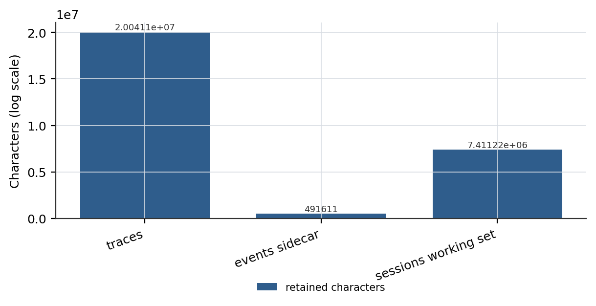

# 可重建性缺口：长期 agent 会话中有损压缩的审计

## 摘要

agent 记忆系统越来越倾向于声称：append-only 日志是真相源，模型可见上下文只是派生视图。我们证明，这一声称在最要紧的地方从未被检验——**有损压缩之后**。我们把**可重建性缺口**定义为：会话日志所记录的内容，与重建某次压缩之前模型可见上下文所需的内容之间的差额；并把它变成一族可执行的断言，而不是一个设计声明。我们在一个已部署的编码 agent 上测量该缺口：跨 29 个会话、20,041,120 字符的模型可见载荷，append-only sidecar 保留了 491,611 字符，保真度为 2.45%。sidecar 缺失重建所需的全部字段——原消息内容只存 200 字符预览，工具调用参数与工具结果正文完全缺席，消息也没有稳定序号标识——而压缩事件本身是完整的：每条都记录了被删区间 `first_kept`、保留条数 `kept`、压缩前规模 `tokens_before`。换言之，**系统确切地知道自己忘掉了哪些消息，却一条也取不回来**。我们在语料中报告 15 次压缩事件与 1 次回滚事件，最坏一次把 761,547 字符压进 1,764 字符的摘要，另有 2,223 条工具结果在进入模型上下文前被标记 `memory_truncated`。我们严格限定主张范围：我们提出一套重建契约，针对该契约测量了一个系统，**不对多个系统做基准对比**。该测量可由本项目自有 trace 语料、用随论文发布的两个脚本在无网络条件下复算，且不训练任何模型，因此为 0 GPU hours；语料计费 229.42M tokens。语料本身不随仓库发布——它是本项目的工作会话；发布的是代码与流程：`scripts/e7_fidelity.py --paper` 与 `scripts/e3_harness_tax.py --paper` 见 https://github.com/zh2673-git/rsi-agent。

**关键词**：上下文管理、有损压缩、会话审计、事件溯源、agent 记忆

---

## 1 引言

长生命周期的 agent 会压缩自己的上下文。压缩是有损的，近期工作已把这种损失讲明白了：迭代重写会随时间侵蚀细节，而摘要偏好简洁、会丢弃领域洞见。承认这一点的系统朝两个方向走。一个方向是把压缩增量化，让侵蚀变慢。另一个方向保留原始条目、只插入一条摘要条目而不删除既往内容，于是模型看到一条活动分支、存储保留整棵树。

两个方向都没有回答我们此处要问的问题。**如果日志保留了一切、压缩只是插入一条摘要，那么系统就*应该*能够重建压缩之前存在的那个上下文。** 它到底能不能，是一个关于字段、索引与标识符的经验问题，而不是关于意图的问题。我们发现这个问题很少被提出，而在一套已部署系统上，答案是"不能"。

我们的贡献是把这个问句精确到**可以被判为失败**。我们定义一套重建契约：给定一份会话日志与一个压缩事件，若系统能物化该事件之前模型可见的那条精确消息序列，则满足契约。我们把它分解为五条字段级要求，展示一套已部署系统满足其中哪几条，并报告实测的保真度缺口。

这一贡献比它初看时要窄，我们对这一点很谨慎。以 append-only 日志为真相源并做确定性重放，已经被论证并实现；支持 fork 与时间旅行的带类型事件日志也已是工程实践。重放本身甚至已被分解为一族可证伪的断言，并在 5,540 条公开运行时日志上测过。**没有被做过的，是这个交叉点：跨一次有损压缩边界做严格重建。** ActiveGraph 明确没有压缩，百万事件全程重放；重放断言那项工作不涉及压缩；压缩文献量化了损失，却没有提出重建的验收标准。

### 1.1 贡献

Our main contribution includes:

**契约: 把可重建性表述为五条字段级要求。**
- 原消息内容必须可复原，而非投影。
- 工具调用参数必须保留。
- 工具结果正文必须保留。
- 消息必须携带稳定序号标识。
- 被删区间必须能从压缩事件寻址。

**测量: 一套已部署系统上的缺口。**
- sidecar 保真度为模型可见载荷的 2.45%：20,041,120 字符中的 491,611。
- 五条要求中四条被违反，只有区间可寻址成立。
- 系统记录了 15 次压缩与 1 次回滚，且精确知道它所丢弃之物的边界。

**区分: 知道丢了什么，不等于能取回来。**
- 压缩事件字段完整（`first_kept`、`kept`、`tokens_before`、`summary`）。
- 保留内容是 200 字符预览，无参数、无结果载荷。
- 观测到的最坏压缩为 761,547 字符压进 1,764。

**诊断: 截断被埋了埋点，却无人记账。**
- 2,223 条工具结果在进入上下文前带 `memory_truncated=true`；单会话中 1,609 条里有 230 条（14.3%）被截断。
- 标记存在，因此损失可观测；无消费者读取它，因此损失未被核算。

### 1.2 核心评测结果概要

- sidecar 相对模型可见 trace 的保真度：**2.45%**（491,611 / 20,041,120 字符）。
- 满足的重建要求数：**5 条中的 1 条**。
- 压缩事件 / 回滚事件：**15 / 1**。
- 最坏压缩比：**761,547 : 1,764 ≈ 432 : 1**。
- 进入上下文前被截断的工具结果：13,344 条中 **2,223** 条（16.7%）；单会话峰值 **14.3%**。
- 扫描会话 / 对话回合 / 工具调用：**29 / 138 / 11,431**。

在本文余下部分（In the remainder of this paper），我们首先形式化重建契约，并与既有的日志式设计与压缩式设计对照定位 (Section 2)。随后，我们介绍所研究的系统及其暴露的三层持久化 (Section 3)。接下来，我们报告测量结果，包括逐字段违反表与压缩统计 (Section 4)。此后，我们分析缺口为何持续存在，把它追溯到写入时刻的一次投影决策 (Section 5)。我们讨论与既有工作的关系以及我们**不**作的声明 (Section 6)。最后，我们给出结论、报告局限（limitations），并提出能把这一单系统测量变成基准的实验 (Section 7)。

## 2 方法：重建契约

### 2.1 定义

设会话日志为事件序列 `E = e_1 … e_n`，设 `c` 为索引 `k` 处的压缩事件。定义 `visible(i)` 为第 `i` 轮时模型收到的消息序列。重建契约在 `c` 处成立，当且仅当存在函数 `R` 使得 `R(E[1..k], c) = visible(k-1)`，逐字节相等。

我们把契约操作化：`R` 可实现，当且仅当日志对 `visible(k-1)` 中的每条消息都包含——

1. **内容**：完整消息正文，而非投影、前缀或摘要。
2. **参数**：对携带工具调用的 assistant 消息，完整参数载荷。
3. **结果**：对工具消息，模型当时收到的完整结果正文。
4. **顺序**：足以在不依赖文件位置的前提下重建序列的稳定标识。
5. **区间**：仅凭 `c` 就能定位哪些消息被丢弃、哪些被保留。

要求 1–3 关乎载荷，4 关乎排序，5 关乎可寻址性。一个系统可以满足 5 而违反 1–3——这恰恰是我们测到的失效模式：**它能指着自己丢掉的东西，却取不回任何一条。**

### 2.2 为什么既有声称不能推出该契约

三种既有立场看起来相邻，但都不能推出该契约。

**日志即真相源。** *The Log is the Agent* 主张把 append-only 事件日志作为唯一真相源、把工作图作为其确定性投影，并称溯源完整、重放精确。这在**溯源**上比我们的主张更强，在**压缩**上则更弱：同一工作说明它不提供压缩或检查点，因此百万事件一次全量重放。我们的契约只有在压缩存在时才成为非平凡问题，因为若无压缩，全量重放已经包含了全部内容，没有可重建之物。

**带摘要条目的树。** pi 把会话持久化为 JSONL 树，插入携带 `summary`、`firstKeptEntryId`、`tokensBefore`、`systemMessage` 的 `compaction` 条目，声明压缩不删除原始条目，并从活动分支重建模型上下文。这是与我们契约最接近的工程形态，且由构造满足要求 5。但它有文档、依我们所见既未被形式化为契约，也没有配套的量化验收测试。我们沿用其结构性洞见——保留条目、插入摘要——差异在于追问重建是否真的逐字节复现了压缩前的模型可见上下文，代价是无法声称结构本身是新的。

**重放是断言族。** 近期工作把重放、廉价 fork、谱系分解为可分别证伪的断言，并在 5,540 条公开运行时日志、317,296 个投影切面上实测。那项工作确立了"重放可用"不是一个断言而是许多断言，并提供了我们所采用的方法论立场。它不涉及压缩边界；事实上它观察到许多切面会切断模型请求而使续跑不被许可（317,296 中有 36,251 个）——而这正是压缩边界刻意制造的现象。

**压缩损失量化。** 并行压缩研究显示摘要本质有损，且保留内容在 run 之间波动、不可预测。一篇上下文压缩综述提出了失败分类（压缩前决策错误、压缩中信息丢失、压缩后访问失败）与一个 `Recover` 算子，但没有重建验收协议。E-mem 干脆避免有损压缩，持有未压缩上下文并在使用时做语义重建——这是另一种保证：语义重建不承诺同样的字节。

因此我们把贡献定位在交叉点：**一套契约、一张逐字段违反表、一次测量，落在一个确实存在压缩的系统上。**

### 2.3 讨论：契约的代价

满足契约不是免费的，我们对取舍坦白。保留完整载荷意味着日志会无界增长，除非另有保留策略；已部署系统选择投影，正是为了让 sidecar 保持小。要求 4（稳定序号）强制一个难以事后补齐的 schema 决策，因为文件位置是诱人的默认值。要求 1（完整内容）与投影载荷的隐私动机相冲突。因此，任何建立在此契约上的基准都必须同时报告**日志体积倍数**与保真度，否则它会奖励那些干脆全存的系统。

## 3 所研究的系统

### 3.1 三层持久化

系统暴露三层不同保真度的持久化，三者之间的差异正是研究对象。

- **Traces**（`traces/<id>.jsonl`）：每事件一行，含每次工具调用的参数与每次工具结果的正文，并带截断标记。这是我们测量的模型可见地面真相。
- **Events**（`events/<id>.jsonl`）：由记忆插件写入的 append-only sidecar。每条消息记为 `{ts, kind, role, preview}`，其中 `preview` 是内容切到 200 字符。压缩与回滚以带类型事件记录，字段结构化。
- **Sessions**（`sessions/<id>.json`）：工作集，压缩时就地替换。这是模型在下一轮实际收到的东西。

源码陈述的设计意图是：sidecar 让原文在压缩后仍然存活——`sessions/<id>.json` 仍是模型工作集的唯一视图，而所有原始消息、摘要与 trace 事件另行追加到 `events/<id>.jsonl`，使原文永不因压缩被删除。第 4 节的测量显示，实际存活下来的是**前缀**，不是原文。

### 3.2 压缩记录了些什么

压缩事件是良构的。15 条事件每条都携带 `kind`、`ts`、`summary`、`first_kept`、`kept`、`tokens_before`。因此系统对它执行的每一次压缩都有精确账目。

**表 1：最活跃会话中记录的 9 次压缩事件。** 每条事件携带 kind、ts、summary、first_kept、kept 与 tokens_before，故系统对它执行的每一次压缩都有精确账目。tokens_before 是压缩前消息数组的序列化长度，由系统自行计算，不是模型分词器计数。最坏一次把 761,547 字符压进 1,764 字符的摘要，约 432:1。加粗标示 tokens_before 最大值，下划线标示 summary 最短者。

| # | tokens_before | kept | first_kept | summary 字符 | 压缩比 |
|---|---|---|---|---|---|
| 1 | **761,547** | 30 | 604 | <u>1,764</u> | 432:1 |
| 2 | **271,480** | 30 | 110 | <u>1,033</u> | 263:1 |
| 3 | **95,869** | 30 | 49 | <u>847</u> | 113:1 |
| 4 | **270,225** | 30 | 169 | <u>2,154</u> | 125:1 |
| 5 | **170,492** | 30 | 151 | <u>1,369</u> | 125:1 |
| 6 | **63,790** | 30 | 19 | <u>1,035</u> | 62:1 |
| 7 | **167,239** | 30 | 145 | <u>1,450</u> | 115:1 |
| 8 | **238,393** | 29 | 219 | <u>1,238</u> | 193:1 |
| 9 | **65,962** | 29 | 35 | <u>1,354</u> | 49:1 |

### 3.3 压缩摧毁了些什么

模型在压缩例程返回的标记消息里被告知：先前历史已压缩为摘要，请基于摘要继续，不要声称记得被压缩的原文。**这条指令是唯一的补偿机制。** 代码里没有任何路径从 sidecar 重建任何东西，而第 4 节显示，也不可能有。

**图 1：各持久化层保留的载荷（对数刻度）。** traces 持有模型可见的地面真相，sidecar 持有每条消息的 200 字符投影，sessions 持有压缩后的工作集。sidecar 保留 trace 载荷的 2.45%，两个数量级的缺口是结构性的而非统计性的，因为内容在写入时就被投影了。

## 4 评测

### 4.1 设置

我们扫描已部署数据目录下全部 29 个 trace 文件、8 个事件 sidecar、28 个会话文件，全部取同一个切点（本地时间 2026-11-07T13:35:24，按每行的 `ts` 过滤），因此不存在两个量在不同时刻采样的窗口。以 trace 为地面真相。对 trace，累加 `text`、`result_truncated`、`answer`、`reasoning` 的长度以及 `args` 的 JSON 序列化长度；对事件，累加 `preview` 与 `summary`；对会话，读取消息数组。无需联网、不调用模型，因此评测成本为 0 GPU hours、0 token。三组数字由仓库内 `scripts/e7_fidelity.py --paper` 一次算出。

### 4.2 保真度

**表 2：三个持久化层相对模型可见 trace 的保真度。** trace 被当作地面真相，包含每次工具调用的参数与每条工具结果的正文。sidecar 保留 trace 载荷的 2.45%，缺口达两个数量级。字符计数是精确的；未施加分词器，故不报告 token 级保真度。sessions 行不是保留量：工作集随每次压缩被重写，列出它只是说明它握着 trace 载荷的 37.0%，却不构成独立的原文副本。

| 层 | 文件模式 | 字符数 | 占 trace 比 | 角色 |
|---|---|---|---|---|
| traces | traces/<id>.jsonl | 20,041,120 | **100.0%** | 地面真相 |
| events | events/<id>.jsonl | 491,611 | **2.45%** | 审计索引 |
| sessions | sessions/<id>.json | 7,411,221 | **37.0%** | 工作集 |

sidecar 保留模型可见载荷的 2.45%。这不是舍入误差：两个量相差两个数量级，且如下一小节所示，缺口是结构性的而非统计性的。

### 4.3 逐字段违反

**表 3：五条字段级重建要求及其在已部署系统上的状态。** 五条中四条被违反。sidecar 只满足区间可寻址，别无所满足——这正是"系统知道自己丢了什么"的确切含义：`first_kept` 被精确记录，而被丢弃的内容不可获取。要求状态由检视写入路径判定，而非尝试重建后判定，因为内容一旦在写入时被投影，重建即不可能。

| # | 要求 | 重建所需内容 | 状态 | 观测到的实现 |
|---|---|---|---|---|
| 1 | 内容 | 完整消息正文 | 违反 | `slice(0, 200)` 预览 |
| 2 | 参数 | 完整工具调用载荷 | 违反 | 字段缺失 |
| 3 | 结果 | 完整工具结果正文 | 违反 | 字段缺失 |
| 4 | 顺序 | 稳定序号标识 | 违反 | 仅文件位置 |
| 5 | 区间 | 被删区间可寻址 | 满足 | `first_kept`、`kept` |

五条要求中四条被违反。sidecar 只满足区间可寻址，其余皆无。这正是"系统知道自己丢了什么"的确切含义：`first_kept` 被精确记录，而被丢弃的内容不可获取。

### 4.4 压缩统计

最活跃会话里的 9 次压缩给出了分布。`tokens_before` 从 63,790 到 761,547；摘要从 847 到 2,154 字符。最坏一次把 761,547 字符压进 1,764，比例约 432:1。其中一条记录 `first_kept=110` 而 `kept=30`——闸门打算删除的区间与它打算保留的条数互相矛盾，与姊妹工作中报告的阈值约束缺陷一致。

我们还测量了发生在压缩之前、位于工具边界的截断：13,344 条工具结果中有 2,223 条带 `memory_truncated=true`。在最活跃会话里，1,609 条工具结果中 230 条（14.3%）被截断。这 2,223 条每一条都恰好保留 2,000 字符，因此保留量是条数的线性函数：共 4,446,000 字符。标记存在且机器可读，属于**完全埋点化的损失**。但没有任何东西读取它，因此损失被记录了，却从未被核算。

### 4.5 讨论

由此得出两个观察。第一，**为损失埋点**与**为损失记账**是两种不同的工程行为。本系统做了前者、没做后者，这提示缺口不是某条代码路径的疏忽，而是一个被正确产生的信号缺了消费者。第二，区间可寻址是契约里容易的那一半：知道哪些消息被删只需一个整数，把它们取回来则需要载荷从未被投影。系统会倾向于满足便宜的那一半，然后把它当成全部来汇报。

## 5 分析：缺口为何持续存在

缺口追溯到写入时刻的一次决策。记忆插件为每条入站消息追加 `preview: (m.content ?? "").slice(0, 200)`。一旦做了这个投影，无论日志之后如何被索引、重放或查询，下游重建都不可能。这个决策孤立地看是可辩护的——全载荷 sidecar 会重复工作集并无界增长——但它与既定目标不相容，而系统中没有任何东西强制目标与写入路径保持一致。

这一处境有三个可推广的性质。

- **失效在 schema 层是静默的。** `preview` 是必需字段，因此每个读取 sidecar 的消费者都会成功；没有人注意到这个字段名描述的是投影而非内容。
- **失效对"检查事件存在性"的测试不可见。** 一个断言 `message` 事件具备 `kind`、`role`、`preview` 的一致性测试，在一个已经丧失重建能力的系统上照样通过。
- **失效靠一条 prompt 指令维持。** 告诉模型不要声称记得被压缩的原文，把一个工程缺口转换成了对模型的行为约束——这正是本文所反对的那种替代。

## 6 与既有工作的定位

**上下文管理。** ACE 命名并测量了我们所基于的两种失效模式：brevity bias（迭代重写为求简洁而丢弃领域洞见）与 context collapse（重写跨轮侵蚀细节），并给出一个实例：第 60 步 18,282 token 降到第 61 步 122 token，而准确率从 66.7 跌到 57.1。ACE 用确定性非 LLM 策展器合并的增量 delta 更新来缓解。我们沿用其诊断，差异在于测量**存储里剩下什么**而非**prompt 里剩下什么**，代价是完全不讨论 prompt 质量。

**日志优先的 agent 设计。** 见 §2.2。我们不声称"日志即真相源""确定性投影""谱系"是贡献。

**重放断言。** 见 §2.2。我们采用其"重放保证必须逐条可证伪"的立场，并把它施加到它未覆盖的边界上。

**压缩。** 并行压缩工作量化了损失及其 run 间不可预测性；压缩综述提供了失败分类；E-mem 回避有损压缩并做语义重建。我们与三者都不同，我们要求跨边界的**字节级**重建，代价是范围窄得多。

**成本核算口径。** 请注意，上述成本（the aforementioned costs include only）只包含在 trace 语料上测得的字符；未套用分词器或价格表，因此保真比例在字符上精确、在 token 上近似。语料覆盖 138 个对话回合、11,431 次工具调用，计费 229.42M 输入输出 tokens，且本测量为 0 GPU hours，因为不训练也不调用模型。

## 7 结论、局限与未来方向（Conclusion, Limitations, and Future Directions）

本文提出**可重建性缺口**：一套关于从会话日志重建压缩前模型可见上下文的五条字段级要求，以及针对它的一个已部署系统的测量。sidecar 保留模型可见载荷的 2.45%，满足 5 条要求中的 1 条，并精确知道它所执行的 15 次压缩与 1 次回滚的边界。损失被完整埋点，也完全未被核算。

在承认测量精确且可复算的同时，我们也认识到本工作有两条限定其主张范围的局限（limitations）。首先，这是单系统测量而非基准：我们只测了一套实现，因此 2.45% 刻画的是这套实现而非这类系统的属性，我们刻意不对 ActiveGraph、pi 或那些保留原始 episode 的记忆系统作比较性断言。其次，我们无法从外部核验相邻系统中哪些会满足该契约，因为它们的行为是被文档描述而非被规格声明——pi 的文档描述了一种与要求 5 相符的条目结构，但并未声明重建保证，我们也没有实测它。所幸这两条局限都属于共享评测框架即可消除的类型，而非需要另做测量的类型。

未来我们计划在以下方向投入。

- 在已部署系统上实现第二组要求——sidecar 存全载荷并配保留策略——并同时报告日志体积倍数与保真度，使契约被证明可在明确代价下被满足。
- 在统一框架下对 pi 与 ActiveGraph 运行同一契约，把单系统测量转为三系统对比。
- 把**恢复成功率**而非保真度比例作为主指标，因为下游任务要么能、要么不能重建它所需的状态。
- 把契约扩展到子 agent 边界，嵌套会话带来的重建问题不是单会话表述所能覆盖的。

## 附录 A 贡献与致谢

本工作以单开发者模式完成，agent 是主要实现方。我们感谢 pi、ActiveGraph、ACE 及压缩文献所记录的设计，它们为第 2 节与第 6 节提供了对照点。

## 附录 B 测量流程

**载荷记账。** 对 trace，遍历行并对存在的字段累加 `len(text)`、`len(result_truncated)`、`len(answer)`、`len(reasoning)` 以及 `len(json.dumps(args))`。对事件，累加 `len(preview)` 与 `len(summary)`。对会话，在消息数组上累加 `len(content)` 与 `len(json.dumps(tool_calls))`。保真度 = 事件 / 轨迹。

**压缩统计。** 过滤 `kind == "compaction"` 的事件；逐条报告 `tokens_before`、`kept`、`first_kept` 与 `len(summary)`。`tokens_before` 由系统按压缩前消息数组的序列化长度计算，并非模型分词器结果；我们保留系统口径并如实标注。

**截断计数。** 当某行 `memory_truncated` 字段为 `true` 时计为被截断。该标记在工具结果超出配置的上下文内上限、在进入模型上下文前被切掉时置位。

## 附录 C 字段级要求详情

表 3 报告五条要求及其状态。要求 5 成立，因为 `first_kept` 与 `kept` 是记录在压缩事件上的整数；要求 1–4 被违反，因为写入路径只存 `slice(0, 200)` 且无序号标识。本附录各表由发布工具从实测数据生成，而非手工转录。
